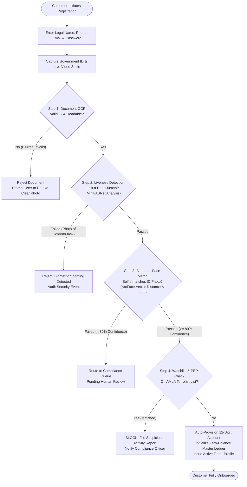
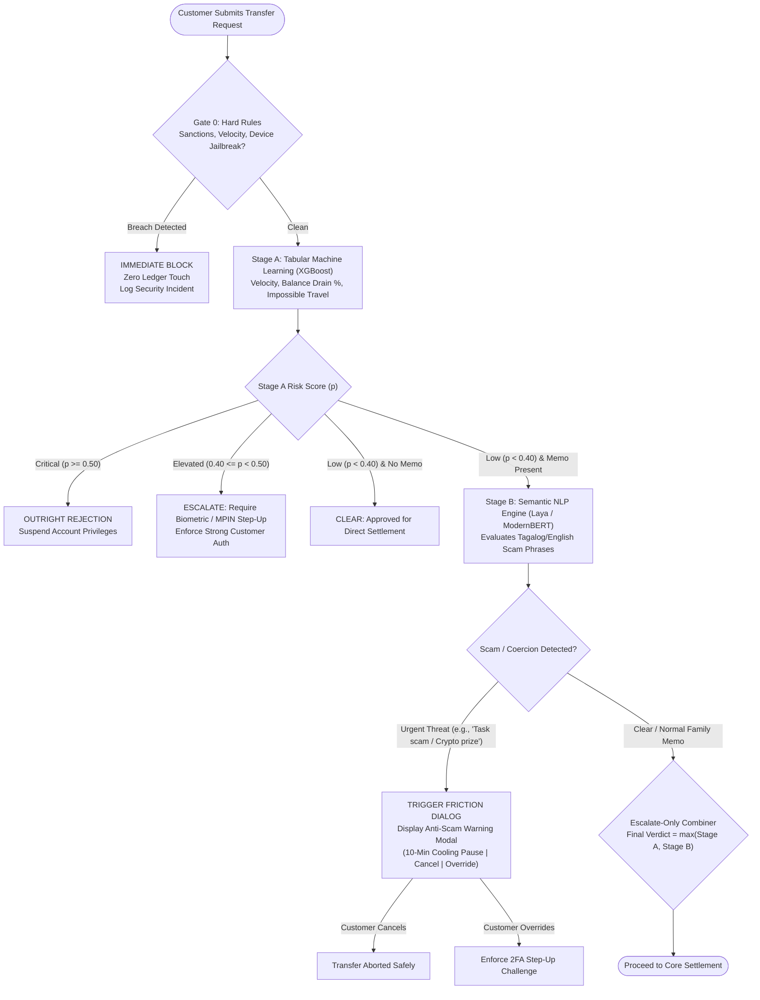
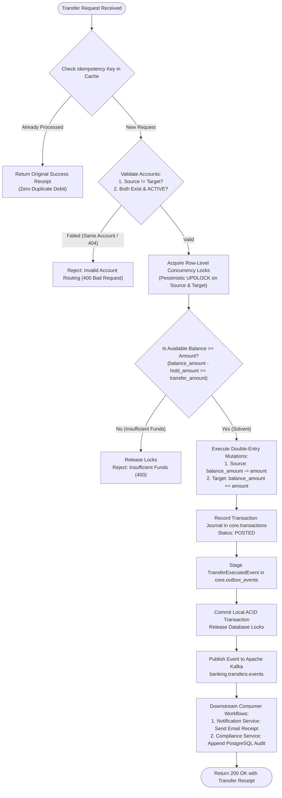
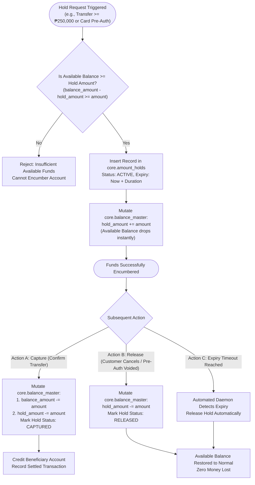
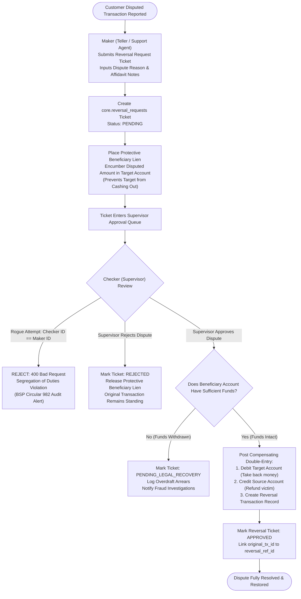
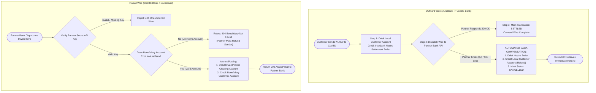
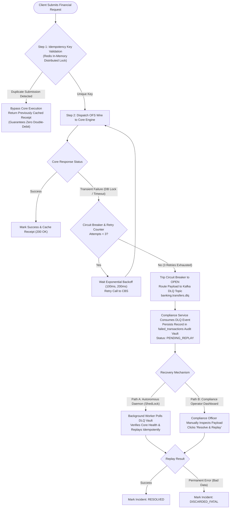
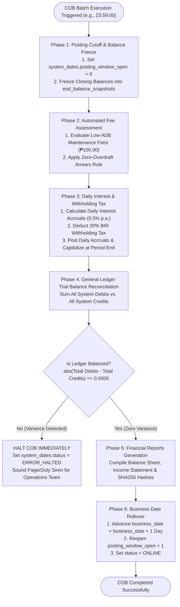

# Core Banking Processes: Theoretical & Logical Breakdown (ELI15)

This document provides a comprehensive, information-dense, yet beginner-friendly (ELI15 — *Explain Like I'm 15*) breakdown of the banking processes implemented in this platform. It bridges theoretical commercial banking principles, regulatory compliance rules, and the operational workflows that govern modern digital financial institutions.

---

## Table of Contents

1. [Foundational Banking Principles & The Banker's Lexicon](#1-foundational-banking-principles--the-bankers-lexicon)
   - [1.1 Why Banks Aren't Just Web Apps with Databases](#11-why-banks-arent-just-web-apps-with-databases)
   - [1.2 The General Ledger & Double-Entry Accounting](#12-the-general-ledger--double-entry-accounting)
   - [1.3 Ledger Balance vs. Available Balance vs. Holds](#13-ledger-balance-vs-available-balance-vs-holds)
   - [1.4 The Segregation of Duties (Maker-Checker Principle)](#14-the-segregation-of-duties-maker-checker-principle)
   - [1.5 Nostro, Vostro, and Interbank Settlement](#15-nostro-vostro-and-interbank-settlement)
   - [1.6 The Bank Business Day & Close of Business (COB)](#16-the-bank-business-day--close-of-business-cob)
   - [1.7 Glossary of Unfamiliar Banking & Regulatory Terms](#17-glossary-of-unfamiliar-banking--regulatory-terms)
2. [Process 1: Customer Identity Lifecycle & Electronic KYC (e-KYC)](#2-process-1-customer-identity-lifecycle--electronic-kyc-e-kyc)
   - [2.1 The Logical Need](#21-the-logical-need)
   - [2.2 Step-by-Step Flowchart](#22-step-by-step-flowchart)
   - [2.3 Happy Path Workflow](#23-happy-path-workflow)
   - [2.4 Negative & Edge-Case Paths](#24-negative--edge-case-paths)
3. [Process 2: Real-Time Fraud & Anti-Money Laundering (AML) Screening](#3-process-2-real-time-fraud--anti-money-laundering-aml-screening)
   - [3.1 The Logical Need](#31-the-logical-need)
   - [3.2 Multi-Gate Risk Pipeline Flowchart](#32-multi-gate-risk-pipeline-flowchart)
   - [3.3 Happy Path Workflow (Instant Clearance)](#33-happy-path-workflow-instant-clearance)
   - [3.4 Negative & Intervention Paths (Friction Dialog, 2FA Step-Up, Block, SAR)](#34-negative--intervention-paths-friction-dialog-2fa-step-up-block-sar)
4. [Process 3: Intra-Bank Funds Transfer (Book Transfer)](#4-process-3-intra-bank-funds-transfer-book-transfer)
   - [5.1 The Logical Need](#41-the-logical-need)
   - [4.2 Step-by-Step Flowchart](#42-step-by-step-flowchart)
   - [4.3 Happy Path Workflow](#43-happy-path-workflow)
   - [4.4 Negative Paths (Solvency, Circular Routing, Dormant Accounts)](#44-negative-paths-solvency-circular-routing-dormant-accounts)
5. [Process 4: Amount Holds, Provisional Locking & Anti-Scam Cooling-Off](#5-process-4-amount-holds-provisional-locking--anti-scam-cooling-off)
   - [5.1 The Logical Need](#51-the-logical-need)
   - [5.2 Lifecycle Flowchart (Place, Hold, Capture, Release)](#52-lifecycle-flowchart-place-hold-capture-release)
   - [5.3 Happy Path Workflows (Cooling-Off & Merchant Pre-Auth)](#53-happy-path-workflows-cooling-off--merchant-pre-auth)
   - [5.4 Negative Paths (Expired Hold, Insufficient Unencumbered Funds)](#54-negative-paths-expired-hold-insufficient-unencumbered-funds)
6. [Process 5: Intra-Bank Transaction Reversal & Dispute Management](#6-process-5-intra-bank-transaction-reversal--dispute-management)
   - [6.1 The Logical Need](#61-the-logical-need)
   - [6.2 Maker-Checker Reversal Flowchart](#62-maker-checker-reversal-flowchart)
   - [6.3 Happy Path Workflow (Dual Authorization & Compensating Journal)](#63-happy-path-workflow-dual-authorization--compensating-journal)
   - [6.4 Negative Paths (Rogue Self-Approval, Beneficiary Spent Funds, Checker Rejection)](#64-negative-paths-rogue-self-approval-beneficiary-spent-funds-checker-rejection)
7. [Process 6: Interbank Funds Transfer & Bilateral Settlement](#7-process-6-interbank-funds-transfer--bilateral-settlement)
   - [7.1 The Logical Need](#71-the-logical-need)
   - [7.2 Outward & Inward Wire Flowchart](#72-outward--inward-wire-flowchart)
   - [7.3 Outward Wire Happy Path (Nostro Settlement)](#73-outward-wire-happy-path-nostro-settlement)
   - [7.4 Outward Wire Negative Path: Timeout & Saga Compensating Rollback](#74-outward-wire-negative-path-timeout--saga-compensating-rollback)
   - [7.5 Inward Wire Paths (Settlement, Counterparty Verification, 404 Rejection)](#75-inward-wire-paths-settlement-counterparty-verification-404-rejection)
8. [Process 7: Failed Transaction Resilience & Dead Letter Queue (DLQ)](#8-process-7-failed-transaction-resilience--dead-letter-queue-dlq)
   - [8.1 The Logical Need](#81-the-logical-need)
   - [8.2 Zero Double-Debit & DLQ Replay Flowchart](#82-zero-double-debit--dlq-replay-flowchart)
   - [8.3 Idempotency Enforcement Path](#83-idempotency-enforcement-path)
   - [8.4 Circuit Breaker Trip & DLQ Resolution Path](#84-circuit-breaker-trip--dlq-resolution-path)
9. [Process 8: End-of-Day (EOD) & Close of Business (COB) Batch Processing](#9-process-8-end-of-day-eod--close-of-business-cob-batch-processing)
   - [9.1 The Logical Need](#91-the-logical-need)
   - [9.2 6-Phase COB State Machine Flowchart](#92-6-phase-cob-state-machine-flowchart)
   - [9.3 Subfeature 1: Posting Cutoff & Balance Freeze](#93-subfeature-1-posting-cutoff--balance-freeze)
   - [9.4 Subfeature 2: Automated Fees & Zero-Overdraft Arrears](#94-subfeature-2-automated-fees--zero-overdraft-arrears)
   - [9.5 Subfeature 3: Daily Interest Accrual & 20% BIR Withholding Tax](#95-subfeature-3-daily-interest-accrual--20-bir-withholding-tax)
   - [9.6 Subfeature 4: GL Trial Balance Balancing & Business Date Rollover](#96-subfeature-4-gl-trial-balance-balancing--business-date-rollover)
   - [9.7 Negative Path: Trial Balance Out of Balance / Abort](#97-negative-path-trial-balance-out-of-balance--abort)
10. [Process 9: Compliance, AMLA Reporting & Audit Vault](#10-process-9-compliance-amla-reporting--audit-vault)
    - [10.1 Covered Transaction Reporting (CTR >= ₱500,000)](#101-covered-transaction-reporting-ctr--500000)
    - [10.2 Suspicious Activity Reporting (SAR)](#102-suspicious-activity-reporting-sar)
    - [10.3 Immutable Audit Vault Architecture](#103-immutable-audit-vault-architecture)

---

## 1. Foundational Banking Principles & The Banker's Lexicon

### 1.1 Why Banks Aren't Just Web Apps with Databases

In a regular web application (like an e-commerce site or social network), if a database crashes or updates out of order, someone might see an outdated cart or an extra like on a photo. In a **bank**, an incorrect number means regulatory fines, bankruptcy, or criminal liability. 

Money is not a simple integer stored in a database row labeled `balance`. Money in a bank represents **legal obligations**:
1. When you deposit \$1,000 into a bank, the bank does not put your ten \$100 bills into a box with your name on it.
2. The bank legally owes you \$1,000 upon demand. In the bank's accounting books, your money is a **Liability** (debt the bank owes to you).
3. The physical cash or reserve the bank holds is an **Asset**.
4. Every single cent that moves through the bank must have a paper trail showing where it came from, where it went, why it moved, and who authorized it.

> [!IMPORTANT]
> **The Golden Law of Banking**: Money cannot be created or destroyed by an application crash. Every transaction must be **atomic** (all steps succeed or none do) and **strictly balanced** (total debits must equal total credits down to the fourth decimal place).

---

### 1.2 The General Ledger & Double-Entry Accounting

In 1494, a Franciscan friar named Luca Pacioli documented the system used by Venetian merchants: **Double-Entry Bookkeeping**. Banks still run on this exact math today.

Every transaction consists of at least two entries:
- **Debit (DR)**
- **Credit (CR)**

For every transaction, the sum of debits must equal the sum of credits:
$$\sum \text{Debits} = \sum \text{Credits}$$

#### Why "Debit" and "Credit" Confuse Everyone
In layman's everyday speech:
- "I got credited!" means "I got money."
- "My account was debited!" means "Money was taken away."

This is because you are looking at your account statement from **your personal point of view**. But in the bank's **Core Banking System (CBS)**, accounts are recorded from the **bank's point of view**:
- Customer deposits are **Liabilities** (money the bank owes the customer).
- To **decrease** a Liability (when a customer withdraws or transfers money out), the bank **Debits** the customer's deposit account.
- To **increase** a Liability (when a customer receives money), the bank **Credits** the customer's deposit account.

| General Ledger Account Type | Normal Balance | Increased By | Decreased By | Example in AuraBank |
| :--- | :--- | :--- | :--- | :--- |
| **Asset** | Debit | **Debit** | Credit | `1010-CASH-VAULT`, `1020-NOSTRO-CLEARING` |
| **Liability** | Credit | **Credit** | Debit | `2100-CUST-LIAB` (Customer Deposits), `2150-TAX-WITHHOLD-PAYABLE` |
| **Revenue / Income** | Credit | **Credit** | Debit | `4010-FEE-INCOME` (Transfer & maintenance fees) |
| **Expense** | Debit | **Debit** | Credit | `5010-INT-EXPENSE` (Interest paid to savers) |

---

### 1.3 Ledger Balance vs. Available Balance vs. Holds

A common point of confusion for banking customers is having \$10,000 in their account but an ATM telling them they can only withdraw \$7,000. 

AuraBank enforces three distinct balance calculations:

```
┌────────────────────────────────────────────────────────┐
│               LEDGER BALANCE (Current Balance)          │
│               The true accounting balance: $10,000     │
├──────────────────────────┬─────────────────────────────┤
│    AVAILABLE BALANCE     │       AMOUNT HOLDS          │
│  Can be spent right now  │   Provisional reservations  │
│         $7,000           │            $3,000           │
└──────────────────────────┴─────────────────────────────┘
```

1. **Ledger Balance (`balance_amount`)**: The absolute financial sum of all settled, committed debits and credits up to this second.
2. **Amount Hold (`hold_amount`)**: A temporary legal lock or encumbrance on funds. The money is still in the account (the ledger balance has not decreased), but the customer cannot withdraw or transfer it.
3. **Available Balance (`available_balance`)**: The portion of money that is free to be spent:
   $$\text{Available Balance} = \text{Ledger Balance} - \text{Hold Amount}$$

---

### 1.4 The Segregation of Duties (Maker-Checker Principle)

In banking, if a single employee had the power to reverse transactions, modify accounts, or waive debts alone, they could steal money or collude with criminals.

To prevent fraud, commercial banking laws (such as Bangko Sentral ng Pilipinas **BSP Circular 982**) mandate the **Maker-Checker Principle** (also known as the **Four-Eyes Rule**):
- **The Maker**: A bank teller or support agent who notices an issue or receives a dispute. They can draft a request (the ticket), enter notes, and propose an action. **They have zero technical permission to execute the action.**
- **The Checker**: A supervisor, branch manager, or compliance officer. They review the Maker's ticket, verify supporting documents (like customer affidavits), and approve or reject it.
- **The Rule**: The Maker and the Checker **cannot be the same person**. If User A submits a dispute ticket, User A is strictly blocked from approving it.

---

### 1.5 Nostro, Vostro, and Interbank Settlement

How does money move between two different banks (e.g., from AuraBank to CooBS Bank)?
One bank cannot simply write directly to another bank's private SQL database. Instead, they use correspondent banking accounts:
- **Nostro Account ("Our money with you")**: AuraBank opens an account inside CooBS Bank and pre-funds it with cash. When an AuraBank customer sends money to a CooBS customer, AuraBank tells CooBS: *"Pay your customer out of our Nostro account with you!"*
- **Vostro Account ("Your money with us")**: CooBS Bank opens an account inside AuraBank. When a CooBS customer sends money to AuraBank, CooBS tells AuraBank: *"Credit your customer, and deduct that amount from our Vostro account held at your bank."*
- **Bilateral Settlement**: The two banks periodically reconcile their Nostro/Vostro statements to ensure neither side has an unpaid overdraft.

---

### 1.6 The Bank Business Day & Close of Business (COB)

Unlike internet apps that run continuous 24/7 loops without concept of days, banks operate on formal **Accounting Business Dates**. 
At a specific cutoff time (e.g., 5:00 PM or midnight), the bank executes **Close of Business (COB)** or **End-of-Day (EOD)**:
1. **Posting Window Closure**: The bank temporarily freezes the ability to back-date transactions.
2. **Batch Calculations**: The bank processes interest earned, collects monthly maintenance fees, and calculates government taxes across millions of accounts.
3. **General Ledger Reconciliation**: The bank runs a **Trial Balance**: summing every single debit and credit in the entire institution to prove that the ledger balances to zero variance.
4. **Date Rollover**: The bank advances its business calendar from Day $T$ to Day $T+1$.

---

### 1.7 Glossary of Unfamiliar Banking & Regulatory Terms

| Term | ELI15 Plain English Meaning |
| :--- | :--- |
| **CBS (Core Banking System)** | The central nervous system of the bank. It holds the authoritative accounts, balances, and ledger journals. Everything else (mobile apps, web portals) is just a window into the CBS. |
| **Temenos T24 / Transact** | The world's most widely deployed commercial core banking software engine. Our project runs a high-fidelity mock conforming to its message formats. |
| **OFS (Open Financial Services)** | A standardized text message format created by Temenos to command the core bank (e.g., `FUNDS.TRANSFER,AUTH/I/PROCESS...`). Think of it as the SWIFT or SQL of the core engine. |
| **AMLA (Anti-Money Laundering Act)** | Laws designed to stop drug cartels, corrupt politicians, and scammers from cleaning illicit money through bank accounts. |
| **CTR (Covered Transaction Report)** | Mandatory regulatory filing submitted to the Anti-Money Laundering Council (AMLC) whenever any transaction equals or exceeds **₱500,000.00** in a single day, even if not suspicious. |
| **SAR (Suspicious Activity Report)** | A confidential report sent to financial intelligence authorities when a transaction looks fraudulent, structured to evade thresholds, or linked to illegal scams. |
| **ADB (Average Daily Balance)** | The sum of an account's end-of-day balances divided by the number of days in the month. Used to determine if a customer maintained the minimum required balance. |
| **Withholding Tax (BIR 20%)** | The Philippine Bureau of Internal Revenue requires banks to withhold 20% of all interest earned on savings deposits and remit it directly to the government. |
| **Encumbrance / Lien** | A legal claim on someone's funds that freezes them so they cannot be withdrawn while a dispute or court order is being resolved. |
| **Saga Pattern / Compensating Transaction** | A way to undo a distributed operation. If Step 1 debits Bank A, but Step 2 fails to reach Bank B, the system executes an automated compensating transaction to refund Bank A. |
| **DLQ (Dead Letter Queue)** | A digital "safe holding pen" for messages or transactions that suffered catastrophic technical failures. They sit in the DLQ until automated daemons or human compliance officers review and replay them. |
| **Idempotency** | A property ensuring that if you accidentally tap the "Transfer \$500" button four times due to a bad internet connection, the bank only processes the transfer once. |
| **SCA (Strong Customer Authentication)** | Regulatory requirement mandating multi-factor authentication (e.g., Password + Biometrics or OTP) for transactions above certain financial thresholds (e.g., ₱50,000.00). |
| **Cooling-Off Period (BSP Cir. 1140)** | A mandatory safety delay imposed on unusually large transfers (e.g., ₱250,000.00+) to give fraud victims time to realize they are being scammed and cancel the transfer. |

---

## 2. Process 1: Customer Identity Lifecycle & Electronic KYC (e-KYC)

### 2.1 The Logical Need
A bank cannot legally open an account for an anonymous user. Financial regulators enforce strict **Know Your Customer (KYC)** mandates to prevent identity theft, phantom accounts, and money laundering. In a digital bank like AuraBank, onboarding is conducted electronically via the mobile app using computer vision and biometrics.

### 2.2 Step-by-Step Flowchart



### 2.3 Happy Path Workflow
1. **Presentation & Capture**: The user enters their demographic details and uses the mobile app camera to photograph an acceptable primary ID (Passport, UMID, Driver's License) and capture a 3D live facial selfie.
2. **Storage Isolation**: The images are securely uploaded to private cloud blob storage (`kyc-vault`) using temporary time-limited pre-signed access signatures (SAS tokens).
3. **Automated Vision Verification**:
   - The OCR engine extracts the legal name, birthdate, and ID number from the ID card.
   - The liveness analyzer inspects specular reflection, texture grain, and edge depth to prove a living person is in front of the lens.
   - The face-matching model converts both the ID portrait and selfie into 512-dimensional biometric feature vectors and calculates cosine similarity.
4. **Account Provisioning**: With confidence $\ge 80\%$, the system:
   - Creates the customer record in `auth_identity.users`.
   - Generates a unique 12-digit account number (e.g., `100100001234`).
   - Creates the master balance record in `core.balance_master` with balance ₱0.00 and hold ₱0.00.
   - Issues a secure JWT session token.

### 2.4 Negative & Edge-Case Paths
- **Presentation Attack / Spoofing**: If someone holds up a printed photograph or smartphone screen displaying another person's selfie, the liveness model flags presentation attack artifacts and immediately rejects the attempt.
- **Biometric Mismatch**: If an imposter attempts to use a stolen passport, the facial similarity score drops below the 80% threshold. The registration is suspended and placed into the **Staff KYC Review Queue** for a human compliance officer to inspect.
- **AMLA Sanction Watchlist Hit**: If the applicant's name matches sanctioned terrorist or politically exposed persons (PEP) databases, the account is prohibited and an automated compliance ticket is logged.

---

## 3. Process 2: Real-Time Fraud & Anti-Money Laundering (AML) Screening

### 3.1 The Logical Need
Modern retail bank accounts are vulnerable to phishing, unauthorized device takeover, social engineering scams, and money mules. Before any money can leave a customer's account, it must pass through an ultra-fast, multi-stage risk evaluation pipeline that scores tabular data and semantic intent in under 200 milliseconds.

### 3.2 Multi-Gate Risk Pipeline Flowchart



### 3.3 Happy Path Workflow (Instant Clearance)
1. **Telemetry Ingestion**: The transfer request arrives with contextual metadata: IP address, geolocation coordinates, device hardware ID, account transaction velocity (number of transfers in the last hour), and transfer memo (e.g., *"Allowance for grocery"*).
2. **Gate 0 Clearance**: Verification passes that the account is active, not flagged on fraud blacklists, and the device has not been root-compromised.
3. **Stage A Execution (< 2ms)**: The XGBoost model calculates a low risk probability ($p = 0.04$) because the amount is typical for this user and originates from their registered home city.
4. **Stage B Execution**: The semantic language model reads the memo *"Allowance for grocery"* and finds zero linguistic correlation to romance scams, fake investments, or extortion.
5. **Verdict**: The transfer receives an **ALLOW** decision and transitions seamlessly to ledger execution.

### 3.4 Negative & Intervention Paths (Friction Dialog, 2FA Step-Up, Block, SAR)
- **High Tabular Velocity / Impossible Travel**: If a user logged in from Manila and 10 minutes later attempts a transfer from London, the system calculates infinite travel velocity, trips Gate 0, and outright blocks the transaction.
- **Social Engineering Memo Trigger**: If the user writes a memo like *"Crypto investment guaranteed 50% weekly return"*, Stage B's NLP classifier detects an investment scam pattern. The system halts the transfer and displays an **Advisory Friction Dialog** warning the customer: *"Scam Warning: Legitimate investments never guarantee daily returns. Would you like to pause for 10 minutes or cancel?"*
- **Threshold Escalation (SCA Step-Up)**: If the amount is $\ge ₱50,000.00$, the system automatically issues a biometric or 6-digit one-time password (OTP) step-up challenge before money can move.
- **SAR Auto-Drafting**: For any transaction blocked due to high-confidence scam markers, the engine automatically populates a **Suspicious Activity Report (SAR)** draft in the compliance registry for legal escalation.

---

## 4. Process 3: Intra-Bank Funds Transfer (Book Transfer)

### 4.1 The Logical Need
An Intra-Bank transfer (also called an "on-us" or "book" transfer) occurs when both the sender and the receiver maintain deposit accounts at AuraBank. Because both accounts reside in the same core ledger, the money does not need to traverse external national clearing networks. The bank simply debits the sender and credits the receiver in a single atomic database operation.

### 4.2 Step-by-Step Flowchart



### 4.3 Happy Path Workflow
1. **Idempotency Guard**: The system checks the `X-Idempotency-Key`. If this key has not been seen before, an in-memory lock is reserved.
2. **Pessimistic Concurrency Lock**: The Core Banking System locates both accounts and locks their database rows using deterministic ordering. This prevents another simultaneous ATM withdrawal from racing against this transfer.
3. **Solvency Verification**: The core verifies that:
   $$\text{balance\_amount} - \text{hold\_amount} \ge \text{transfer\_amount}$$
4. **Atomic Double-Entry Posting**:
   - Sender's `balance_amount` is decremented by ₱100.00.
   - Receiver's `balance_amount` is incremented by ₱100.00.
   - A row is written to `core.transactions` with status `POSTED`.
   - The general ledger records: Debit Customer Liabilities (Sender), Credit Customer Liabilities (Receiver). Net bank balance change: exactly ₱0.00.
5. **Outbox Staging & Emission**: Within the exact same database transaction, a `TransferExecutedEvent` is written to `core.outbox_events`.
6. **Customer Receipt**: Once committed, the locks are freed, an asynchronous email receipt is sent, and the client receives a `200 OK` response with the unique transaction reference.

### 4.4 Negative Paths (Solvency, Circular Routing, Dormant Accounts)
- **Insufficient Funds / Overdraft Rejection**: If an account has ₱500.00 available and attempts to transfer ₱1,000.00, the solvency check halts execution immediately. Zero balances change.
- **Circular Self-Transfer**: If a customer mistakenly enters their own account as both source and destination, the validation rejects the request (`Source and destination account must be different`).
- **Non-Existent Beneficiary**: If the destination account number does not exist in `core.accounts`, the core rejects the request with an explicit `Account not found` error.
- **Dormant or Frozen Account**: If the receiver's account has been legally frozen by law enforcement or marked `LOCKED`, the transaction is blocked before any funds leave the sender.

---

## 5. Process 4: Amount Holds, Provisional Locking & Anti-Scam Cooling-Off

### 5.1 The Logical Need
In banking, you frequently need to ring-fence money without actually sending it away immediately. 
Examples include:
1. **Car Rental / Hotel Pre-Authorizations**: The merchant holds \$200 for incidentals. If you don't break anything, the hold vanishes.
2. **High-Value Anti-Scam Cooling-Off (BSP Circular 1140)**: When a retail customer suddenly transfers a massive sum (e.g., ₱300,000.00), the bank immediately locks the funds for a mandatory cooling-off window (e.g., 4 to 24 hours). The money is frozen so the user cannot be drained by fraudsters, allowing them time to verify the recipient.

### 5.2 Lifecycle Flowchart (Place, Hold, Capture, Release)



### 5.3 Happy Path Workflows (Cooling-Off & Merchant Pre-Auth)
1. **Cooling-Off Placement**: A customer transfers ₱300,000.00. Because this exceeds the ₱250,000.00 threshold, the core banking engine places an `ACTIVE` hold.
2. **Encumbrance Effect**: The sender's ledger balance remains ₱500,000.00, but their `hold_amount` increases from ₱0 to ₱300,000.00. Their available balance drops to ₱200,000.00. They cannot spend that ₱300,000.00 elsewhere.
3. **Capture Execution**: Once the cooling-off window expires safely or the user confirms identity via out-of-band challenge, the orchestrator instructs the core to **Capture** the hold. The ledger balance drops by ₱300,000.00, the hold amount drops by ₱300,000.00, and the funds are credited to the recipient.

### 5.4 Negative Paths (Expired Hold, Insufficient Unencumbered Funds)
- **Insufficient Unencumbered Funds**: An account with ₱100,000.00 total balance already has a ₱70,000.00 hold for a pending check. If an attempt is made to place a new hold of ₱40,000.00, the operation fails because available funds are only ₱30,000.00.
- **Hold Expiry Void**: If a merchant pre-authorizes a card hold but fails to submit the final settlement file within 7 days, the core banking system's automated background sweeper detects `expiry_date < CURRENT_TIMESTAMP` and safely un-encumbers the funds, returning the available balance to the customer.

---

## 6. Process 5: Intra-Bank Transaction Reversal & Dispute Management

### 6.1 The Logical Need
What happens when a customer falls victim to a mistaken duplicate payment, an unauthorized fraudulent withdrawal, or a system glitch? 
In commercial banking, **transactions cannot be simply deleted with an SQL `DELETE` statement**. 
To reverse a settled transaction:
1. Every historical record must remain permanently intact.
2. A formal dispute ticket must be raised.
3. Dual-authorization (**Maker-Checker**) must be strictly obeyed.
4. An opposite, **compensating double-entry journal** must be executed to balance the books.

### 6.2 Maker-Checker Reversal Flowchart



### 6.3 Happy Path Workflow (Dual Authorization & Compensating Journal)
1. **Maker Ticket Creation**: Teller `usr-1003-tel-001` receives a formal customer affidavit disputing a ₱150.00 transfer (`TXN-REV-SEED`). The teller creates a dispute ticket. Status is `PENDING`.
2. **Protective Lien Placement**: The core banking engine immediately places an amount hold (a **lien**) on the recipient's account for ₱150.00. This guarantees that while the investigation is underway, the recipient cannot run to an ATM and withdraw the disputed money.
3. **Checker Verification**: Supervisor `usr-1004-adm-001` opens their management dashboard, reviews the ticket details, verifies that their user ID differs from the teller, and clicks **Approve**.
4. **Compensating Journal Execution**: The core banking engine posts an atomic compensating transaction:
   - Debit: Recipient Account for ₱150.00 (releasing the lien).
   - Credit: Original Sender Account for ₱150.00 (restoring their balance).
   - Status transitions to `APPROVED`, and both transactions are mutually cross-referenced in the database.

### 6.4 Negative Paths (Rogue Self-Approval, Beneficiary Spent Funds, Checker Rejection)
- **Segregation of Duties Violation**: If the teller who drafted the dispute ticket attempts to call the approval endpoint with their own user ID, the core engine blocks the request with an explicit error: `Maker and Checker cannot be the same user`.
- **Beneficiary Already Drained the Funds**: If the recipient quickly withdrew the money before the lien could be placed, their account balance is ₱0.00. The core banking engine will not allow an illegal negative balance overdraft. The ticket is marked `FAILED_UNCOLLECTIBLE` and escalated to legal recovery and law enforcement.
- **Supervisor Rejection**: If the supervisor finds that the transaction was legitimate (e.g., a customer trying to back out of a purchased item they already received), the supervisor rejects the ticket. The protective lien is released, and the original transfer remains final.

---

## 7. Process 6: Interbank Funds Transfer & Bilateral Settlement

### 7.1 The Logical Need
When a customer sends money to a friend at a different financial institution (such as our partner institution, CooBS Bank), the transfer must cross organizational boundaries. Because network timeouts, remote server crashes, and clearing latency can occur, the system must utilize **Distributed Sagas** to ensure that money is never debited from the customer if the external bank fails to receive it.

### 7.2 Outward & Inward Wire Flowchart



### 7.3 Outward Wire Happy Path (Nostro Settlement)
1. **Local Debit & Nostro Credit**: AuraBank immediately debits the customer's account for ₱1,000.00 and credits the internal clearing account `1020-NOSTRO-CLEARING`. The money is safely quarantined in the bank's interbank buffer.
2. **Wire Dispatch**: The orchestrator formats the wire payload and sends an HTTPS REST message to CooBS Bank's ingress endpoint.
3. **Partner Acknowledgment**: CooBS Bank confirms receipt (`200 OK`, `PartnerRef: B-TXN-OK`) and credits their customer.
4. **Finality**: AuraBank marks the local transaction `POSTED`.

### 7.4 Outward Wire Negative Path: Timeout & Saga Compensating Rollback
1. **Network Partition / Remote Crash**: AuraBank debits the customer ₱500.00 and calls CooBS Bank. CooBS Bank's server hangs or drops the connection.
2. **Timeout Detection**: AuraBank's HTTP client reaches its 5-second socket timeout and raises a `TimeoutException`.
3. **Automated Saga Rollback**: The system does not leave the customer wondering where their money went. It immediately triggers an automated compensating transaction:
   - Debit `1020-NOSTRO-CLEARING` for ₱500.00.
   - Credit the customer's account for ₱500.00.
   - Updates transaction status to `CANCELLED` with reason `Saga rollback: Partner bank timeout`.
   - The customer sees their balance instantly restored with a clear explanation.

### 7.5 Inward Wire Paths (Settlement, Counterparty Verification, 404 Rejection)
- **Happy Path**: CooBS Bank sends an inward wire of ₱2,500.00 to AuraBank with an authorized header `X-Interbank-API-Key`. AuraBank verifies the key, confirms the destination account exists, debits the Vostro buffer, credits the local customer, and returns `200 ACCEPTED`.
- **Rogue Ingress Rejection (401)**: An unauthenticated actor attempts to trigger an inward credit without the shared banking cryptographic key. The gateway rejects the call immediately.
- **Non-Existent Beneficiary (404)**: CooBS sends a wire for account `ACC-INVALID-999`. AuraBank checks its database, finds no such account, rejects the wire, and informs CooBS so they can refund their customer.

---

## 8. Process 7: Failed Transaction Resilience & Dead Letter Queue (DLQ)

### 8.1 The Logical Need
In real-world enterprise infrastructure, networks drop packets, databases undergo failovers, and services experience memory spikes. If a system crashes mid-transaction, how do we guarantee that a customer is **never double-debited** and that stuck money is **never lost in digital limbo**?

### 8.2 Zero Double-Debit & DLQ Replay Flowchart



### 8.3 Idempotency Enforcement Path
When a mobile app sends a payment request, it attaches a unique `X-Idempotency-Key` (e.g., a UUID generated on the phone).
- When the gateway receives the request, it executes an atomic `SETNX` (Set if Not Exists) in Redis.
- If the user experiences an elevator ride or subway tunnel where their screen freezes and they frantically mash the "Submit" button 5 times, requests 2 through 5 are intercepted by the idempotency guard. They do not re-execute the transfer; they simply return the stored receipt of request 1.

### 8.4 Circuit Breaker Trip & DLQ Resolution Path
1. **Failure Escalation**: If the Core Banking System is undergoing a rolling reboot and cannot answer within 3 retries, the Transfer Orchestrator trips its circuit breaker.
2. **Dead Letter Queue (DLQ) Offloading**: Rather than discarding the customer's request or giving an unrecoverable error, the orchestrator packages the full transaction context and publishes it to the Kafka DLQ topic: `banking.transfers.dlq`.
3. **Audit Vault Ingestion**: The Compliance Service consumes the DLQ event and logs it into `failed_transaction_history` with error codes and retry counters.
4. **Autonomous Replay Daemon**: An automated background daemon governed by distributed locks (**ShedLock**) continuously monitors the DLQ table. Once the core engine returns to healthy status, the daemon re-executes the transaction without customer intervention.

---

## 9. Process 8: End-of-Day (EOD) & Close of Business (COB) Batch Processing

### 9.1 The Logical Need
At the end of every banking day, a financial institution must consolidate its books, deduct recurring fees, award interest to savings depositors, compute government taxes, and ensure that every single ledger account balances. This process is called **Close of Business (COB)**.

### 9.2 6-Phase COB State Machine Flowchart



### 9.3 Subfeature 1: Posting Cutoff & Balance Freeze
To calculate interest and fees accurately, balances must stand still.
1. The engine updates `core.system_dates`, setting `posting_window_open = 0`. Any non-batch transaction submitted during this window receives an immediate `403 Forbidden: Posting window closed for COB`.
2. The engine executes a snapshot query, copying every account's current ledger balance into `core.eod_balance_snapshots` timestamped with the current `business_date`.

### 9.4 Subfeature 2: Automated Fees & Zero-Overdraft Arrears
Banks charge monthly maintenance fees if a customer fails to maintain the required minimum Average Daily Balance (ADB):
- Fee rule: If `closing_balance < ₱1,000.00`, assess a monthly low-ADB maintenance fee of ₱100.00.
- **The Zero-Overdraft Law**: Regulators strictly forbid banks from pushing a deposit account into negative balance due to automated maintenance fees.
  - If the customer has ₱30.00: The bank collects ₱30.00. Balance becomes ₱0.00.
  - The remaining ₱70.00 is logged into `core.uncollected_fees` with status `UNCOLLECTED`.
  - Next month, if the customer deposits money, the arrears are automatically collected.

### 9.5 Subfeature 3: Daily Interest Accrual & 20% BIR Withholding Tax
Banks advertise annual interest rates (e.g., 0.5% per annum), but interest is calculated **daily** based on each night's closing balance:
$$\text{Daily Accrual} = \text{Closing Balance} \times \frac{\text{Annual Rate}}{365}$$
$$\text{Tax Withheld} = \text{Daily Accrual} \times 20\% \quad (\text{BIR Mandate})$$
$$\text{Net Accrual} = \text{Daily Accrual} - \text{Tax Withheld}$$

The net interest is recorded in `core.interest_accruals`. On the final day of the month (**Capitalization Day**), the sum of all net accruals is credited directly into the customer's account balance, and the tax liability is transferred to the government tax payable ledger (`2150-TAX-WITHHOLD-PAYABLE`).

### 9.6 Subfeature 4: GL Trial Balance Balancing & Business Date Rollover
Before a bank can declare the day finished, the General Ledger must balance:
- Total Debits must equal Total Credits down to four decimal places (`0.0000`).
- If variance is zero, the engine advances `business_date` by +1 day (e.g., from `2026-10-07` to `2026-10-08`), re-enables `posting_window_open = 1`, and returns the core banking system to `ONLINE` status.

### 9.7 Negative Path: Trial Balance Out of Balance / Abort
If a software bug caused a single-sided debit without a matching credit during the day, the Trial Balance reconciliation detects a non-zero variance (e.g., Debits exceed Credits by ₱50.00). 
The engine **halts the COB sequence immediately**, locks the system into `ERROR_HALTED`, logs an emergency incident, and prevents date rollover until financial controllers manually balance the ledger.

---

## 10. Process 9: Compliance, AMLA Reporting & Audit Vault

### 10.1 Covered Transaction Reporting (CTR >= ₱500,000)
Under Philippine Anti-Money Laundering legislation (RA 9160 / RA 10365):
- Any cash or digital transaction involving a total amount exceeding **₱500,000.00** (or its equivalent in foreign currency) within one banking day is a **Covered Transaction**.
- The Core Banking System's event stream automatically flags these transactions and dispatches them to the Compliance Service.
- The Compliance Service compiles the mandated regulatory XML/JSON filing for automatic transmission to the Anti-Money Laundering Council (AMLC).

### 10.2 Suspicious Activity Reporting (SAR)
Unlike CTRs (which are based solely on mathematical amount thresholds), a **Suspicious Activity Report** is triggered by behavioral anomalies regardless of amount:
- Structuring transactions just under reporting limits (e.g., making four separate transfers of ₱49,000.00 in 10 minutes to avoid the ₱50,000.00 threshold).
- Accounts flagged for involvement in online phishing, mule accounts, or malware extortion.
- When flagged by the Risk Engine, an automated SAR case record is created containing the actor ID, device fingerprints, IP location trace, and LLM threat synthesis report.

### 10.3 Immutable Audit Vault Architecture
Financial auditors and regulatory examiners require proof that bank logs have not been tampered with by database administrators or rogue engineers.
- Every state change, ledger posting, and security decision is streamed to an isolated, append-only **PostgreSQL Audit Vault** (`ledger_mutation_audit`).
- Audit vault records cannot be updated or deleted (`REVOKE UPDATE, DELETE ON ALL TABLES`).
- Every entry contains a cryptographic SHA-256 integrity hash linking it to previous entries, providing mathematical proof of chronological immutability.
