# Core Banking Platform: Comprehensive Technical Breakdown & Systems Architecture

This document provides a rigorous, deep technical specification of the core banking platform. It details component architectures, microservice contracts, database schemas, cryptographic and concurrency mechanisms, request-response lifecycles, and sequence diagrams covering every happy and negative execution path across all implemented banking capabilities.

---

## Table of Contents

1. [Architectural Topology & Microservice Infrastructure](#1-architectural-topology--microservice-infrastructure)
   - [1.1 Physical & Logical System Topology](#11-physical--logical-system-topology)
   - [1.2 Microservice Component Matrix & Port Allocations](#12-microservice-component-matrix--port-allocations)
   - [1.3 Multi-Tier Data Storage Architecture](#13-multi-tier-data-storage-architecture)
2. [Advanced Technical Concepts & Protocols Explained](#2-advanced-technical-concepts--protocols-explained)
   - [2.1 Temenos Open Financial Services (OFS) Wire Protocol](#21-temenos-open-financial-services-ofs-wire-protocol)
   - [2.2 Concurrency & Concurrency Isolation: `UPDLOCK, ROWLOCK`](#22-concurrency--concurrency-isolation-updlock-rowlock)
   - [2.3 Distributed Idempotency Engine (Redis `SETNX` & Hash Storage)](#23-distributed-idempotency-engine-redis-setnx--hash-storage)
   - [2.4 Transactional Outbox Pattern & At-Least-Once Delivery](#24-transactional-outbox-pattern--at-least-once-delivery)
   - [2.5 Distributed Saga Pattern & Automated Compensating Rollbacks](#25-distributed-saga-pattern--automated-compensating-rollbacks)
   - [2.6 Circuit Breakers & Dead Letter Queue (DLQ) Replay Semantics](#26-circuit-breakers--dead-letter-queue-dlq-replay-semantics)
   - [2.7 Distributed Cron Clustering via ShedLock](#27-distributed-cron-clustering-via-shedlock)
   - [2.8 Refresh Token Rotation (RTR) & Token Family Breach Detection](#28-refresh-token-rotation-rtr--token-family-breach-detection)
   - [2.9 Computer Vision Biometrics: ArcFace 512-D & MiniFASNet](#29-computer-vision-biometrics-arcface-512-d--minifasnet)
3. [Technical Flow 1: Authentication, Token Lifecycle & RTR Breach Detection](#3-technical-flow-1-authentication-token-lifecycle--rtr-breach-detection)
   - [3.1 Sequence Diagram: Happy Path Login & Refresh Token Rotation](#31-sequence-diagram-happy-path-login--refresh-token-rotation)
   - [3.2 Sequence Diagram: Negative Path — Replayed Token Breach & Session Revocation](#32-sequence-diagram-negative-path--replayed-token-breach--session-revocation)
4. [Technical Flow 2: Mobile e-KYC Identity Verification Pipeline](#4-technical-flow-2-mobile-e-kyc-identity-verification-pipeline)
   - [4.1 Sequence Diagram: Happy Path SAS Intent, OCR & ArcFace Face Match](#41-sequence-diagram-happy-path-sas-intent-ocr--arcface-face-match)
   - [4.2 Sequence Diagram: Negative Path — Biometric Spoof & Mismatch Rejection](#42-sequence-diagram-negative-path--biometric-spoof--mismatch-rejection)
5. [Technical Flow 3: Real-Time Multi-Stage Fraud & NLP Risk Scoring](#5-technical-flow-3-real-time-multi-stage-fraud--nlp-risk-scoring)
   - [5.1 Sequence Diagram: Happy Path Sub-2ms Real-Time Clearance](#51-sequence-diagram-happy-path-sub-2ms-real-time-clearance)
   - [5.2 Sequence Diagram: Negative Path — Scam Memo Friction Dialog & Step-Up 2FA](#52-sequence-diagram-negative-path--scam-memo-friction-dialog--step-up-2fa)
6. [Technical Flow 4: Intra-Bank Funds Transfer via Temenos OFS & Outbox](#6-technical-flow-4-intra-bank-funds-transfer-via-temenos-ofs--outbox)
   - [6.1 Sequence Diagram: Happy Path Atomic Ledger Posting & Kafka Emission](#61-sequence-diagram-happy-path-atomic-ledger-posting--kafka-emission)
   - [6.2 Sequence Diagram: Negative Paths — Overdraft & Routing Rejections](#62-sequence-diagram-negative-paths--overdraft--routing-rejections)
7. [Technical Flow 5: Amount Holds & Provisional Reservations (`AC.LOCKED.EVENTS`)](#7-technical-flow-5-amount-holds--provisional-reservations-aclockedevents)
   - [7.1 Sequence Diagram: Anti-Scam Cooling-Off Hold Placement & Capture](#71-sequence-diagram-anti-scam-cooling-off-hold-placement--capture)
   - [7.2 Sequence Diagram: Negative Path — Void / Automated Expiry Sweep](#72-sequence-diagram-negative-path--void--automated-expiry-sweep)
8. [Technical Flow 6: Maker-Checker Transaction Reversal & Beneficiary Lien](#8-technical-flow-6-maker-checker-transaction-reversal--beneficiary-lien)
   - [8.1 Sequence Diagram: Happy Path Maker Ticket, Lien & Checker Compensating Journal](#81-sequence-diagram-happy-path-maker-ticket-lien--checker-compensating-journal)
   - [8.2 Sequence Diagram: Negative Path — Segregation of Duties Violation (400 Bad Request)](#82-sequence-diagram-negative-path--segregation-of-duties-violation-400-bad-request)
9. [Technical Flow 7: Interbank Outward & Inward Wire Settlement (Bilateral Nostro)](#9-technical-flow-7-interbank-outward--inward-wire-settlement-bilateral-nostro)
   - [9.1 Sequence Diagram: Outward Wire Happy Path Settlement](#91-sequence-diagram-outward-wire-happy-path-settlement)
   - [9.2 Sequence Diagram: Outward Wire Partner Timeout & Automated Saga Rollback](#92-sequence-diagram-outward-wire-partner-timeout--automated-saga-rollback)
   - [9.3 Sequence Diagram: Inward Wire Ingestion & Cryptographic Key Validation](#93-sequence-diagram-inward-wire-ingestion--cryptographic-key-validation)
10. [Technical Flow 8: Failed Transaction Resilience, Circuit Breaker & DLQ Recovery](#10-technical-flow-8-failed-transaction-resilience-circuit-breaker--dlq-recovery)
    - [10.1 Sequence Diagram: Circuit Breaker Trip, DLQ Offload & Autonomous Replay](#101-sequence-diagram-circuit-breaker-trip-dlq-offload--autonomous-replay)
11. [Technical Flow 9: End-of-Day (EOD) / Close of Business (COB) Batch Engine](#11-technical-flow-9-end-of-day-eod--close-of-business-cob-batch-engine)
    - [11.1 Sequence Diagram: Full 6-Phase COB Orchestration Sequence](#111-sequence-diagram-full-6-phase-cob-orchestration-sequence)
    - [11.2 Sequence Diagram: Negative Path — GL Trial Balance Out-of-Balance Abort](#112-sequence-diagram-negative-path--gl-trial-balance-out-of-balance-abort)
12. [Technical Flow 10: Regulatory Compliance, CTR Streaming & Audit Vault](#12-technical-flow-10-regulatory-compliance-ctr-streaming--audit-vault)
    - [12.1 Sequence Diagram: AMLA Covered Transaction Ingestion & Tamper-Proof Audit](#121-sequence-diagram-amla-covered-transaction-ingestion--tamper-proof-audit)

---

## 1. Architectural Topology & Microservice Infrastructure

### 1.1 Physical & Logical System Topology

The platform enforces a zero-trust network boundary between public presentation channels, the application gateway perimeter, asynchronous event buses, and the authoritative core banking enclave:

```
┌────────────────────────────────────────────────────────────────────────┐
│                        PRESENTATION LAYER                              │
│         React 18 Admin/Teller Web Portal   |   Flutter Mobile App       │
└───────────────────────────────────┬────────────────────────────────────┘
                                    │ HTTPS / WSS / JWT
                                    ▼
┌────────────────────────────────────────────────────────────────────────┐
│                   PERIMETER & EDGE GATEWAY TIER                        │
│                     Spring Cloud Gateway (:8080)                       │
│    ├── Perimeter JWT Signature Validation                              │
│    ├── Token Bucket Rate Limiting                                      │
│    └── Redis Session / Revocation Cache (:6379)                        │
└──────────┬────────────────────────┬──────────────────────────┬─────────┘
           │                        │                          │
           ▼                        ▼                          ▼
┌────────────────────┐   ┌──────────────────────┐   ┌────────────────────┐
│  Account Service   │   │Transfer Orchestrator │   │    Risk Engine     │
│ Spring Boot :8081  │   │  Spring Boot :8082   │   │  FastAPI / Python  │
│ Auth, KYC, Profile │   │Flow & OFS Translation│   │    Port :8084      │
└──────────┬─────────┘   └──────────┬───────────┘   └──────────┬─────────┘
           │                        │                          │
           │                        │ Synchronous HTTP/OFS Wire│
           │                        ▼                          │
           │             ┌──────────────────────┐              │
           │             │     T24 Mock CBS     │              │
           │             │  Spring Boot :8085   │              │
           │             │Authoritative Enclave │              │
           │             └──────────┬───────────┘              │
           │                        │ Exclusive JDBC           │
           │                        ▼                          │
           │             ┌──────────────────────┐              │
           └────────────►│  Azure SQL Database  │◄─────────────┘
                         │     Port :1433       │
                         │Master Ledgers/Outbox │
                         └──────────┬───────────┘
                                    │ Direct Outbox Publish
                                    ▼
                         ┌──────────────────────┐
                         │     Apache Kafka     │
                         │      Port :9092      │
                         │Event Bus & DLQ Topics│
                         └──────────┬───────────┘
                                    │ Event Streaming
                     ┌──────────────┴──────────────┐
                     ▼                             ▼
       ┌───────────────────────────┐ ┌───────────────────────────┐
       │   Notification Service    │ │    Compliance Service     │
       │     Spring Boot :8083     │ │     Spring Boot :8086     │
       │   MailHog / SSE Emitter   │ │  Audit Worker & DLQ Replay│
       └───────────────────────────┘ └─────────────┬─────────────┘
                                                   │
                                                   ▼
                                     ┌───────────────────────────┐
                                     │  PostgreSQL Audit Vault   │
                                     │         Port :5432        │
                                     │  Immutable Append-Only Log│
                                     └───────────────────────────┘
```

### 1.2 Microservice Component Matrix & Port Allocations

| Service Identifier | Technology Stack | Runtime Port | Primary Architectural Responsibilities |
| :--- | :--- | :--- | :--- |
| **API Gateway** (`gateway`) | Spring Boot 3, Spring Cloud Gateway, Netty | `8080` | Perimeter TLS termination, JWT token validation, distributed rate-limiting, CORS handling, and dynamic routing. |
| **Account Service** (`account-service`) | Spring Boot 3, Spring Data JPA, HikariCP | `8081` | User registration, password hashing (BCrypt strength 10), Refresh Token Rotation, 12-digit account provisioning, balance inquiries via cache-aside. |
| **Transfer Orchestrator** (`transfer-orchestrator`) | Spring Boot 3, Resilience4j, Spring WebClient | `8082` | Distributed idempotency locks (`SETNX`), synchronous Risk screening orchestration, 2FA step-up enforcement, Temenos OFS wire serialization, Saga rollback compensation, and DLQ routing. |
| **Notification Service** (`notification-service`) | Spring Boot 3, Kafka Consumer, JavaMailSender | `8083` | Ingests `banking.transfers.events` from Kafka, renders responsive HTML transaction receipts, delivers emails via MailHog SMTP, and streams Server-Sent Events (SSE). |
| **Risk Engine / Laya Engine** (`risk-service`) | Python 3.11, FastAPI, XGBoost, PyTorch, PaddleOCR | `8084` | Sub-2ms Gate 0 deterministic rules, Stage A tabular XGBoost fraud model, Stage B non-autoregressive transformer memo evaluation (Taglish NLP), e-KYC face matching (ArcFace), and liveness detection. |
| **T24 Mock CBS** (`t24-mock-cbs`) | Spring Boot 3, Spring JDBC, HikariCP, Kafka Producer | `8085` / `8087` | **The Authoritative Core Banking Enclave**: Exclusive connection to Azure SQL Master database, OFS parsing, pessimistic row-level locking (`UPDLOCK`), double-entry balance mutation, transactional outbox logging, and COB batch execution. |
| **Compliance & Reporting** (`compliance-service`) | Spring Boot 3, ShedLock, Spring Data JPA | `8086` | Ingests domain events and DLQ incidents, writes immutable audit trails to PostgreSQL, compiles AMLA CTR/SAR filings, and executes the autonomous ShedLock DLQ replay daemon. |

### 1.3 Multi-Tier Data Storage Architecture

1. **Azure SQL Database (`sqldb-master` :1433)**: Master operational ledger storing relational entities: `auth_identity.users`, `core.accounts`, `core.balance_master`, `core.transactions`, `core.gl_ledger`, `core.amount_holds`, `core.reversal_requests`, `core.system_dates`, `core.participant_banks`, and `integration.outbox_events`.
2. **Azure PostgreSQL Database (`audit-vault` :5432)**: Append-only, tamper-proof compliance store maintaining `ledger_mutation_audit`, `dlq_incident_audit`, and regulatory AMLA filings. Direct `UPDATE` and `DELETE` SQL privileges are strictly revoked at the database role level.
3. **Redis (`redis` :6379)**: In-memory datastore for token blacklists, refresh token family lineage sets, distributed idempotency locks (`idemp:<key>`), and balance enquiry cache-aside entries (`balance:<account_id>`, TTL 30s).
4. **Azurite / Azure Blob Storage (:10000)**: Secure private object container (`kyc-vault`) for encrypted front/back government ID scans and biometric selfie videos accessed exclusively via 300-second Shared Access Signature (SAS) tokens.
5. **Apache Kafka (:9092)**: High-throughput distributed event log partitioned across core topics:
   - `banking.transfers.events`: Authoritative ledger execution events (`TransferExecutedEvent`, `TransferReversedEvent`, `AmountHoldPlacedEvent`).
   - `banking.batch.events`: Close-of-business lifecycle notifications (`CobCompletedEvent`, `InterestCapitalizedEvent`).
   - `banking.transfers.dlq`: Failed and retried transactions requiring audit vault persistence or operator intervention.

---

## 2. Advanced Technical Concepts & Protocols Explained

### 2.1 Temenos Open Financial Services (OFS) Wire Protocol
Temenos Core Banking engines do not communicate using generic REST JSON. They utilize a proprietary, high-density comma-delimited wire syntax known as **OFS (Open Financial Services)**. The Transfer Orchestrator serializes internal Java request models into OFS strings prior to transmission over internal REST/TCP sockets:

#### Syntax Specification:
`OPERATION,TRANSACTION.TYPE/PROCESS_MODE/VERSION//REFERENCE_ID,CREDENTIALS,FIELD.NAME:SUBFIELD=VALUE,...`

#### Practical Wire Payloads in AuraBank:
- **Intra-Bank Funds Transfer**:
  ```text
  FUNDS.TRANSFER,AUTH/I/PROCESS//FT26095A8812,OPERATOR01/P@ssw0rd1,TRANSACTION.TYPE=AC,DEBIT.ACCT.NO=1000-2000-3001,CREDIT.ACCT.NO=1000-2000-3002,AMOUNT=100.00,CURRENCY=PHP,MEMO=Retail Payment
  ```
- **Amount Hold Placement (`AC.LOCKED.EVENTS`)**:
  ```text
  AC.LOCKED.EVENTS,INPUT/I/PROCESS//HLD8829104,OPERATOR01/P@ssw0rd1,ACCOUNT.NUMBER=1000-2000-3001,HOLD.AMOUNT=300000.00,EXPIRY.DATE=20261015,HOLD.REASON=ANTI_SCAM_COOLING_OFF
  ```
- **Close-of-Business Cutoff (`BATCH.JOB`)**:
  ```text
  BATCH.JOB,CUTOFF/I/PROCESS//COB-20261007,SYSTEM/SUPERVISOR,JOB.NAME=EOD.POSTING.CUTOFF,ACTION=CLOSE_POSTING_WINDOW
  ```

---

### 2.2 Concurrency & Concurrency Isolation: `UPDLOCK, ROWLOCK`
To prevent the catastrophic **Lost Update Problem** (where two simultaneous requests read balance ₱1,000, both subtract ₱800, and leave ₱200 instead of rejecting the second for overdraft), the T24 Mock CBS executes an explicit pessimistic row lock in Azure SQL:

```sql
SELECT balance_amount, hold_amount 
FROM core.balance_master WITH (UPDLOCK, ROWLOCK)
WHERE account_id = @AccountId;
```

- `ROWLOCK`: Instructs the query optimizer to take fine-grained locks strictly on the target account's leaf page rows, avoiding full-table lock escalation.
- `UPDLOCK`: Places an Update Lock immediately during the `SELECT` phase. Other concurrent transactions attempting to read with `UPDLOCK` are forced to queue until the enclosing transaction commits or rolls back.
- **Deadlock Avoidance**: When locking multiple accounts (Source and Destination in a transfer), the application sorts `account_id` strings lexicographically (`account_a.compareTo(account_b)`) and acquires locks in deterministic sorted order.

---

### 2.3 Distributed Idempotency Engine (Redis `SETNX` & Hash Storage)
AuraBank provides a mathematical guarantee of **Zero Double-Debit** through a two-phase distributed lock protocol:

1. **Phase 1: Ingress Acquisition**:
   The client passes `X-Idempotency-Key: IDEMP-TXN-9912`. The Transfer Orchestrator executes:
   ```text
   SET idemp:IDEMP-TXN-9912 "PROCESSING" EX 120 NX
   ```
   - If Redis returns `nil` (key already exists), the engine queries the associated cached receipt. If processing is still underway, it returns `409 Conflict: Concurrent Request in Progress`. If already finished, it returns the stored `200 OK` JSON response directly without touching the database.
   - If Redis returns `OK`, this worker has acquired the exclusive execution lease.
2. **Phase 2: Post-Commit Finalization**:
   Upon receiving confirmation from T24 CBS, the orchestrator updates Redis:
   ```text
   SETEX idemp:IDEMP-TXN-9912 86400 '{"transactionId":"TXN-9912","status":"Posted","amount":100.00}'
   ```
   The idempotency key is preserved for 24 hours (86,400 seconds).

---

### 2.4 Transactional Outbox Pattern & At-Least-Once Delivery
Directly publishing to Apache Kafka inside a database transaction is a severe anti-pattern (if the database commits but Kafka crashes, data diverges; if Kafka succeeds but the database rolls back, downstream systems process phantom money).

AuraBank uses the **Transactional Outbox Pattern**:
1. Within the exact same local ACID transaction as the account balance debit and credit, the CBS writes an entry into `integration.outbox_events`:
   ```sql
   INSERT INTO integration.outbox_events 
   (event_id, aggregate_type, aggregate_id, event_type, payload, status)
   VALUES (@EventId, 'TRANSFER', @TxId, 'TransferExecutedEvent', @JsonPayload, 'PENDING');
   ```
2. The database transaction commits atomically.
3. An internal event publisher dispatcher reads `PENDING` outbox records, dispatches them to Apache Kafka (`banking.transfers.events`), and marks `status = 'PUBLISHED'` and `processed_at = SYSDATETIMEOFFSET()`.

---

### 2.5 Distributed Saga Pattern & Automated Compensating Rollbacks
In interbank transfers across autonomous banking organizations, two-phase commit (2PC) is impossible. AuraBank implements an **Orchestrated Saga Pattern**:

```
[Local Ledger Debit & Nostro Buffer Credit] 
                 │
                 ├── (Success) ──► [Dispatch HTTP Wire to External Partner Bank]
                 │                                │
                 │                                ├── (Partner 200 OK) ──► [Finalize: Mark SETTLED]
                 │                                │
                 └── (Timeout / Remote 5xx) ──────┴──────────────────────► [Automated Compensating Rollback:
                                                                            Reverse Local Debit, 
                                                                            Credit Customer, 
                                                                            Mark CANCELLED]
```

---

### 2.6 Circuit Breakers & Dead Letter Queue (DLQ) Replay Semantics
If the Core Banking System experiences unrecoverable latency or database lock exhaustion, cascading system collapse is prevented via Resilience4j Circuit Breakers:
- **Failure Rate Threshold**: 50% failures over a sliding window of 10 requests.
- **Circuit State Transition**: Transitions from `CLOSED` to `OPEN`. All incoming calls immediately fail fast with `503 Service Unavailable`.
- **DLQ Offloading**: In-flight transactions that exhaust 3 exponential backoff attempts (100ms, 200ms, 400ms) are diverted to Kafka topic `banking.transfers.dlq`.
- **Constrained Replay**: The Compliance Service's background daemon or human operators can trigger replay requests via `POST /api/v1/cbs/audit/failed-transactions/{id}/resolve`. Replays enforce the original idempotency key to prevent double debiting.

---

### 2.7 Distributed Cron Clustering via ShedLock
When multiple pods of `compliance-service` run concurrently in Kubernetes, running batch jobs (such as DLQ auto-recovery or EOD reconciliation) without coordination would cause duplicate executions.

AuraBank uses **ShedLock**:
```sql
CREATE TABLE shedlock (
    name VARCHAR(64) PRIMARY KEY,
    lock_until DATETIMEOFFSET NOT NULL,
    locked_at DATETIMEOFFSET NOT NULL,
    locked_by VARCHAR(255) NOT NULL
);
```
Before executing a batch task, a pod attempts an atomic update on `shedlock`. Only the single pod that wins the database lock executes the batch; all other pods safely skip the execution cycle.

---

### 2.8 Refresh Token Rotation (RTR) & Token Family Breach Detection
To prevent compromised long-lived refresh tokens from allowing infinite unauthorized access, AuraBank implements **Refresh Token Rotation (RTR)**:
1. Every time a refresh token is used, it is **invalidated** and replaced with a brand-new refresh token.
2. Tokens are grouped into a cryptographic **Token Family** stored in Redis: `family:<user_id>:<family_id>`.
3. **Breach Detection**: If an attacker steals a previously used refresh token and attempts to replay it, the server detects that the token was already consumed. This signals that a token theft occurred. The server immediately **revokes the entire token family**, destroying all active sessions for that user across all devices.

---

### 2.9 Computer Vision Biometrics: ArcFace 512-D & MiniFASNet
The e-KYC pipeline utilizes state-of-the-art neural computer vision models:
- **MiniFASNet (Facial Anti-Spoofing Network)**: Analyzes spatial frequency distributions and depth cues in the selfie video to identify printed paper masks, silicone cutouts, and AMOLED display replays.
- **ArcFace (Additive Angular Margin Loss)**: Maps cropped facial images into a hyperspherical embedding space ($\mathbb{R}^{512}$). The distance between the ID photo vector $\vec{v}_{\text{id}}$ and the selfie vector $\vec{v}_{\text{selfie}}$ is calculated using Cosine Distance:
  $$\cos(\theta) = \frac{\vec{v}_{\text{id}} \cdot \vec{v}_{\text{selfie}}}{\|\vec{v}_{\text{id}}\| \|\vec{v}_{\text{selfie}}\|}$$
  If $\cos(\theta) \ge 0.60$ (equivalent to an 80% biometric confidence threshold), the customer's identity is mathematically verified.

---

## 3. Technical Flow 1: Authentication, Token Lifecycle & RTR Breach Detection

### 3.1 Sequence Diagram: Happy Path Login & Refresh Token Rotation

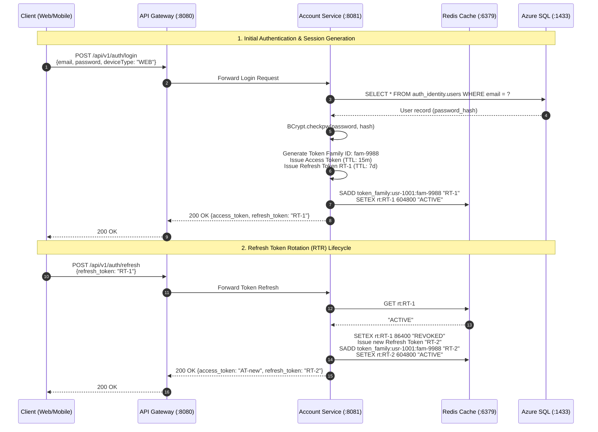

### 3.2 Sequence Diagram: Negative Path — Replayed Token Breach & Session Revocation

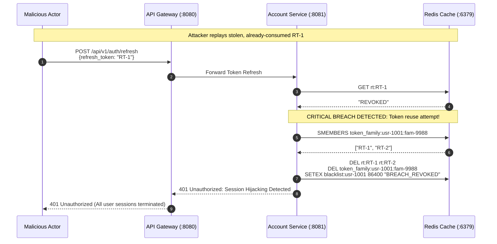

---

## 4. Technical Flow 2: Mobile e-KYC Identity Verification Pipeline

### 4.1 Sequence Diagram: Happy Path SAS Intent, OCR & ArcFace Face Match

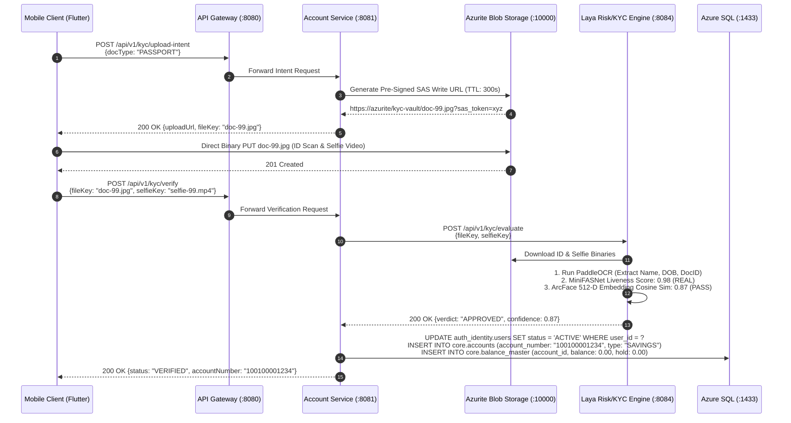

### 4.2 Sequence Diagram: Negative Path — Biometric Spoof & Mismatch Rejection

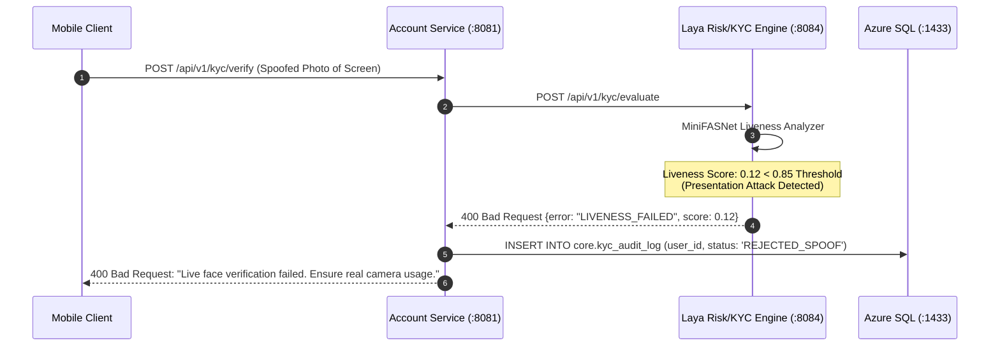

---

## 5. Technical Flow 3: Real-Time Multi-Stage Fraud & NLP Risk Scoring

### 5.1 Sequence Diagram: Happy Path Sub-2ms Real-Time Clearance

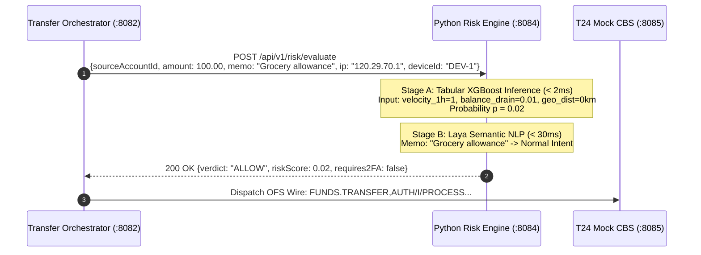

### 5.2 Sequence Diagram: Negative Path — Scam Memo Friction Dialog & Step-Up 2FA

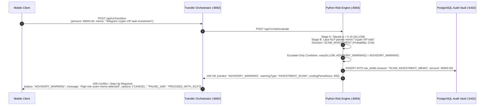

---

## 6. Technical Flow 4: Intra-Bank Funds Transfer via Temenos OFS & Outbox

### 6.1 Sequence Diagram: Happy Path Atomic Ledger Posting & Kafka Emission

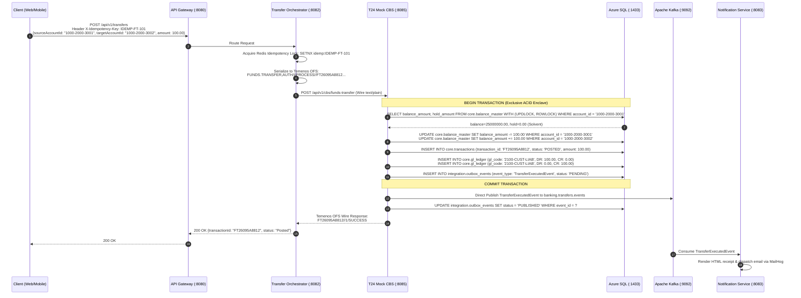

### 6.2 Sequence Diagram: Negative Paths — Overdraft & Routing Rejections

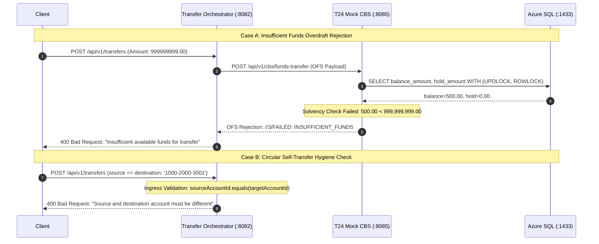

---

## 7. Technical Flow 5: Amount Holds & Provisional Reservations (`AC.LOCKED.EVENTS`)

### 7.1 Sequence Diagram: Anti-Scam Cooling-Off Hold Placement & Capture

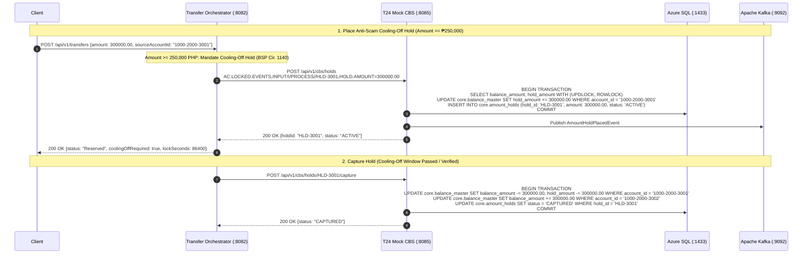

### 7.2 Sequence Diagram: Negative Path — Void / Automated Expiry Sweep

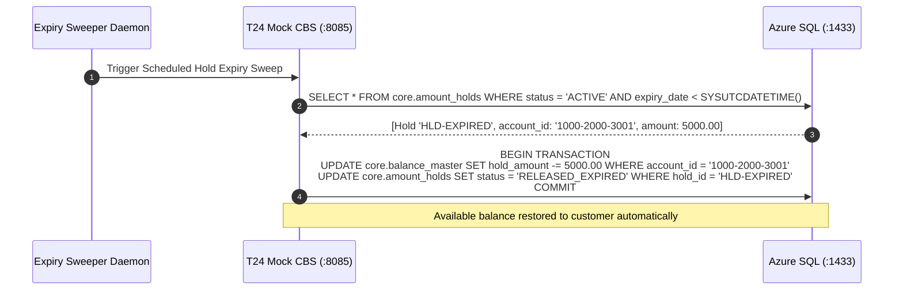

---

## 8. Technical Flow 6: Maker-Checker Transaction Reversal & Beneficiary Lien

### 8.1 Sequence Diagram: Happy Path Maker Ticket, Lien & Checker Compensating Journal

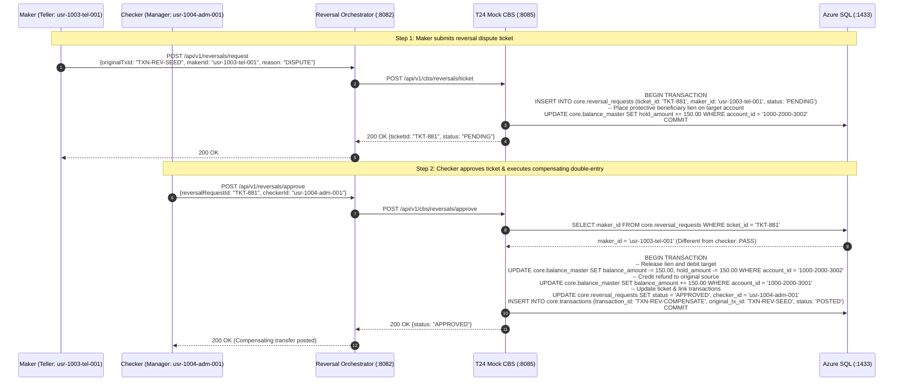

### 8.2 Sequence Diagram: Negative Path — Segregation of Duties Violation (400 Bad Request)

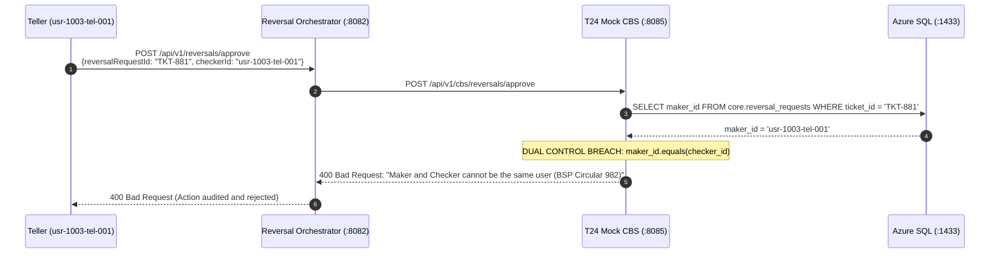

---

## 9. Technical Flow 7: Interbank Outward & Inward Wire Settlement (Bilateral Nostro)

### 9.1 Sequence Diagram: Outward Wire Happy Path Settlement

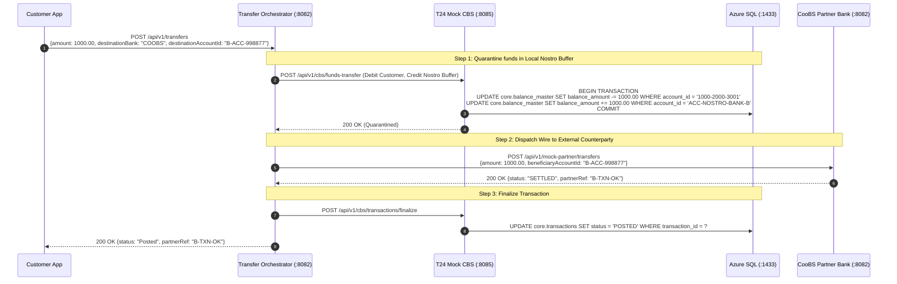

### 9.2 Sequence Diagram: Outward Wire Partner Timeout & Automated Saga Rollback

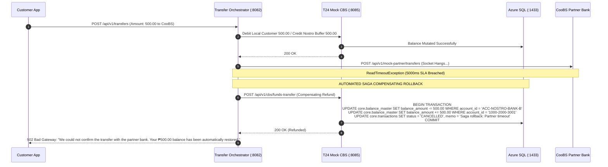

### 9.3 Sequence Diagram: Inward Wire Ingestion & Cryptographic Key Validation

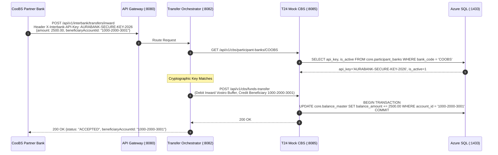

---

## 10. Technical Flow 8: Failed Transaction Resilience, Circuit Breaker & DLQ Recovery

### 10.1 Sequence Diagram: Circuit Breaker Trip, DLQ Offload & Autonomous Replay

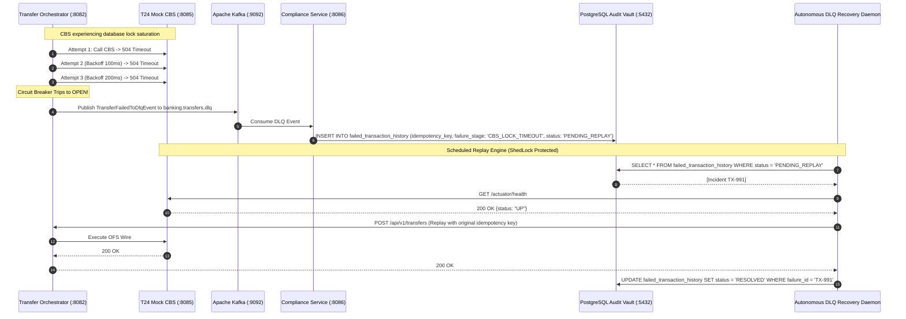

---

## 11. Technical Flow 9: End-of-Day (EOD) / Close of Business (COB) Batch Engine

### 11.1 Sequence Diagram: Full 6-Phase COB Orchestration Sequence

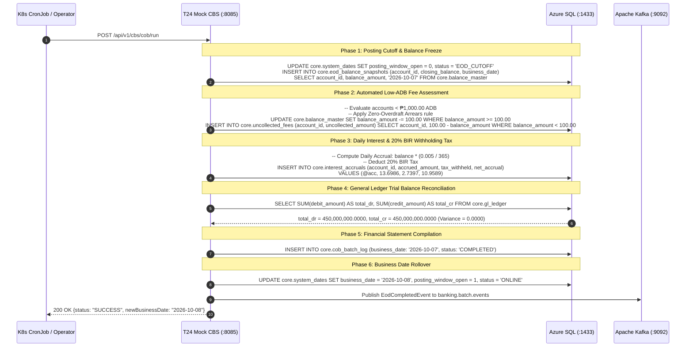

### 11.2 Sequence Diagram: Negative Path — GL Trial Balance Out-of-Balance Abort

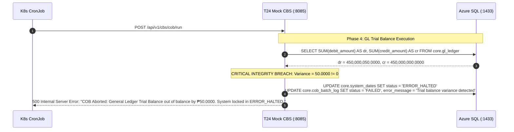

---

## 12. Technical Flow 10: Regulatory Compliance, CTR Streaming & Audit Vault

### 12.1 Sequence Diagram: AMLA Covered Transaction Ingestion & Tamper-Proof Audit

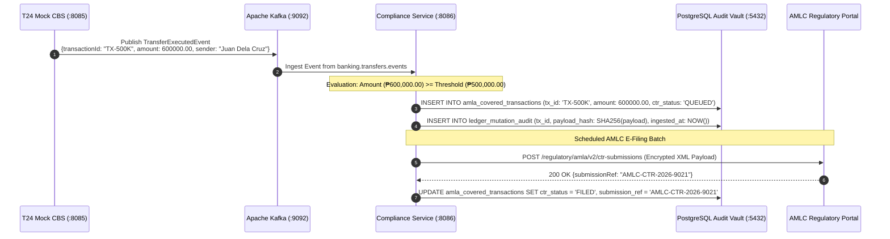
