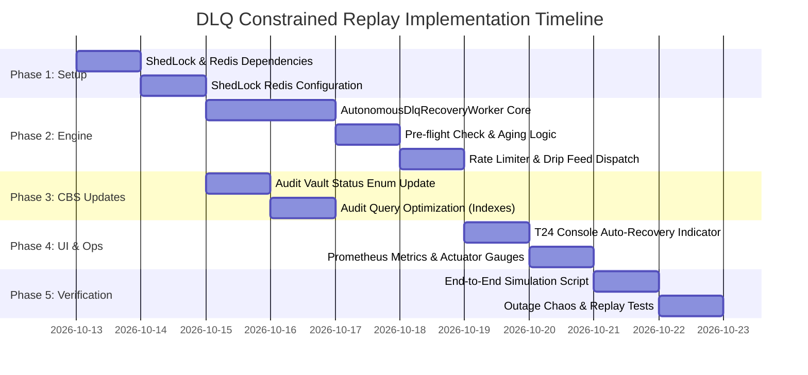
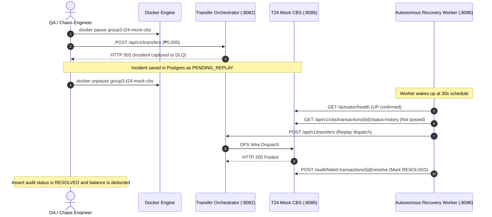

# Constrained DLQ Replay Architecture & Implementation Plan
## Fast-Path / Slow-Path Resilience Pattern for Core Banking

- **Document Version:** 1.0.0
- **Status:** Approved Architecture Plan
- **Target Components:** `compliance-service` (:8086), `transfer-orchestrator` (:8082), `t24-mock-cbs` (:8085), `redis-cache` (:6379), `postgres-audit-vault` (:5432)
- **Target Standard:** BSP Circular 1140 / 1160 (Consumer Protection), BSP Circular 982 (Operational Risk), Resilience4j Circuit Breaker Standards

---

## 1. Executive Summary & Objective

### 1.1 The Problem
In the current production baseline of the retail ledger:
1. **Transfer Orchestrator (:8082)** routes failed or circuit-broken core banking transfers to Kafka topic `banking.transfers.dlq`.
2. **T24 Mock CBS (:8085)** consumes these events into the PostgreSQL Immutable Audit Vault (`failed_transaction_audit`) with status `PENDING_REPLAY`.
3. **No automatic replay exists.** When CBS recovers, pending incidents sit idle in the audit vault until an operator manually triggers replay via the compliance REST API (`POST /api/v1/compliance/dlq/replay/{transferId}`) or the web console (`T24TestConsole.jsx`).

### 1.2 The Solution
Introduce an **Autonomous Constrained Slow-Path Recovery Worker** operating in conjunction with the **Stateless Fast-Path Ingress Gateway**:
* **Fast Path (Ingress Gateway)**: Remains completely stateless and Zero-DB, handling high-throughput customer transfers (<200ms latency). On CBS outage, it fails fast, publishes to `banking.transfers.dlq`, and returns HTTP 503.
* **Slow Path (Recovery Worker)**: Runs in `compliance-service` guarded by **Redis Distributed Locks (ShedLock)** and strict safety constraints. When CBS recovers, it automatically, gently drip-feeds eligible failed transfers back through the orchestrator.

```mermaid
flowchart TD
    subgraph Fast Path [FAST PATH: Stateless Ingress (2 to 50 Replicas)]
        Client[Mobile / Web Client] -->|POST /api/v1/transfers| LB[Load Balancer]
        LB --> Orch[Transfer Orchestrator :8082]
        Orch -->|1. Idempotency & Cool-Off| Redis[(Redis :6379)]
        Orch -->|2. AI Fraud Scoring| Risk[Risk Service :8084]
        Orch -->|3. OFS Wire Call| CBS{CBS Healthy?}
        CBS -- YES --> CoreCommit[ACID Ledger Commit :8085]
        CoreCommit -->|200 OK| Client
        CBS -- NO: Timeout / 503 --> TripCB[Resilience4j CB Trips to OPEN]
        TripCB -->|Publish TransferFailedToDlqEvent| DLQ[(Kafka: banking.transfers.dlq)]
        TripCB -->|503 Fast Fail| Client
    end

    subgraph Audit Storage [IMMUTABLE AUDIT VAULT]
        DLQ --> IngestWorker[CbsAuditSelfConsumptionService]
        IngestWorker --> Vault[(Postgres: failed_transaction_audit<br/>status: PENDING_REPLAY)]
    end

    subgraph Slow Path [SLOW PATH: Autonomous Recovery Worker (Throttled)]
        Vault -->|Poll PENDING_REPLAY| Worker[AutonomousDlqRecoveryWorker<br/>compliance-service :8086]
        Redis -.->|ShedLock: Max 1 Active Worker| Worker
        Worker --> G1{Guard 1: CBS /actuator/health == UP<br/>& CB CLOSED?}
        G1 -- Unhealthy --> Sleep[Backoff & Sleep]
        G1 -- Healthy --> G2{Guard 2: Incident Age < 10 mins?}
        G2 -- Expired (> 10m) --> Expire[Mark EXPIRED_CANCELLED<br/>Notify Customer]
        G2 -- Fresh --> G3{Guard 3: CBS Status History<br/>Already Posted?}
        G3 -- Already Posted --> IdempResolve[Mark RESOLVED_ALREADY_COMMITTED]
        G3 -- Not Posted --> DripFeed[Drip-Feed Re-dispatch<br/>Max 2-5 tx/sec with 300ms Delay]
        DripFeed -->|POST /api/v1/transfers| Orch
        DripFeed --> ResolveAudit[Mark RESOLVED in Vault]
    end
```

---

## 2. Architectural Invariants & Safety Constraints

To guarantee zero duplicate debits, zero crash loops, and strict adherence to banking standards, the Slow-Path Recovery Worker enforces **5 Mandatory Invariants**:

| Invariant | Mechanism | Rationale |
| :--- | :--- | :--- |
| **1. Liveness & Stability Gate** | Polls `/actuator/health` on `:8085` and inspects Resilience4j Circuit Breaker. Must observe `UP` and `CLOSED` state for $\ge 30$ seconds. | Prevents the "Thundering Herd" problem where recovery traffic knocks over a rebooting CBS. |
| **2. Strict 10-Minute TTL** | Checks `failure_timestamp`. If `age > 10 minutes`, marks `EXPIRED_CANCELLED`. | BSP Circular 1160 Consumer Protection: Banking customers assume failed transfers are dead after minutes; delayed auto-deduction causes unexpected overdrafts. |
| **3. Transient Error Filter** | Only replays `CBS_CIRCUIT_BREAKER_OR_TIMEOUT`, `HTTP 503/504`, or `GATEWAY_TIMEOUT`. Semantic errors (`INSUFFICIENT_FUNDS`, `KYC_BLOCKED`) are dismissed. | Eliminates infinite poison-pill retry loops. |
| **4. Pre-Flight Idempotency Check** | Interrogates CBS `GET /api/v1/cbs/transactions/{id}/status-history` before dispatching. | Network timeouts often occur *after* CBS committed the debit. Pre-checking prevents double-mutations. |
| **5. Throttled Drip Feed** | Rate limits re-dispatches to $\le 3$ transactions/sec (300ms inter-dispatch sleep). | Prevents replay traffic from competing with live user ingress. |

---

## 3. Work Breakdown Structure (WBS) & Implementation Tasks



### Phase 1: Distributed Locking & Dependency Setup
* **Task 1.1**: Add `shedlock-spring` and `shedlock-provider-redis-spring` to `backend/compliance-service/pom.xml`.
* **Task 1.2**: Create `ShedLockConfig.java` in `compliance-service` binding ShedLock to the existing Redis connection (`redis-cache:6379`).
* **Task 1.3**: Configure application properties in `application.yml`:
  ```yaml
  app:
    dlq:
      recovery:
        enabled: true
        cron: "*/30 * * * * *" # Every 30 seconds
        max-age-minutes: 10
        batch-size: 10
        throttle-ms: 300
  ```

### Phase 2: Autonomous Recovery Engine Implementation
* **Task 2.1**: Implement `AutonomousDlqRecoveryWorker.java` in `com.bank.compliance.scheduler`.
* **Task 2.2**: Annotate the scheduled task with `@Scheduled` and `@SchedulerLock(name = "AutonomousDlqRecoveryWorker", lockAtMostFor = "25s", lockAtLeastFor = "10s")`.
* **Task 2.3**: Implement `isCbsHealthy()` health-gating logic via `cbsWebClient.get().uri("/actuator/health")`.
* **Task 2.4**: Implement TTL aging filter: if incident `age > 10m`, mark `EXPIRED_CANCELLED` and skip dispatch.
* **Task 2.5**: Implement pre-flight status check: interrogate `/api/v1/cbs/transactions/{id}/status-history`. If already `Posted`, resolve immediately with `IDEMPOTENT_RESOLVED`.
* **Task 2.6**: Implement rate-limited re-dispatch: send to `orchestratorWebClient.post().uri("/api/v1/transfers")` with idempotency key `REPLAY-{transactionId}` and 300ms pause.

### Phase 3: Core Banking System (CBS) Adjustments
* **Task 3.1**: Update `FailedTransactionAudit.java` entity in `t24-mock-cbs` to allow new audit statuses:
  - `PENDING_REPLAY` (Initial capture)
  - `RESOLVED` (Successfully replayed)
  - `EXPIRED_CANCELLED` (Aged past 10-minute TTL)
  - `MANUAL_REVIEW_REQUIRED` (Poison pill or exhausted attempts)
* **Task 3.2**: Add database index to PostgreSQL audit vault schema:
  ```sql
  CREATE INDEX IF NOT EXISTS idx_failed_tx_replay_status_time 
  ON failed_transaction_audit (replay_status, failure_timestamp DESC);
  ```

### Phase 4: Operations Console & Observability
* **Task 4.1**: Update `T24TestConsole.jsx` (Tab 4: DLQ Incident Replays):
  - Add an automated recovery status badge: *"Autonomous Slow-Path Daemon: ACTIVE (ShedLock Synced)"*.
  - Render live status pill colors: Green for `RESOLVED`, Orange for `PENDING_REPLAY`, Slate for `EXPIRED_CANCELLED`.
* **Task 4.2**: Register Micrometer metrics in `compliance-service`:
  - `dlq_replays_attempted_total`
  - `dlq_replays_succeeded_total`
  - `dlq_replays_expired_total`

### Phase 5: Verification & Chaos Testing
* **Task 5.1**: Add automated verification scenario to `scripts/verify-all-banking-features.mjs`:
  - Simulate downstream outage by pausing CBS (`docker pause group3-t24-mock-cbs`).
  - Dispatch a transfer from the orchestrator and verify HTTP 503 + capture in DLQ.
  - Unpause CBS (`docker unpause group3-t24-mock-cbs`).
  - Wait 35 seconds and assert that the incident transitions to `RESOLVED` without manual intervention.

---

## 4. Code Specifications

### 4.1 ShedLock Configuration (`compliance-service`)
**File:** `backend/compliance-service/src/main/java/com/bank/compliance/config/ShedLockConfig.java`
```java
package com.bank.compliance.config;

import net.javacrumbs.shedlock.core.LockProvider;
import net.javacrumbs.shedlock.provider.redis.spring.RedisLockProvider;
import net.javacrumbs.shedlock.spring.annotation.EnableSchedulerLock;
import org.springframework.context.annotation.Bean;
import org.springframework.context.annotation.Configuration;
import org.springframework.data.redis.connection.RedisConnectionFactory;
import org.springframework.scheduling.annotation.EnableScheduling;

@Configuration
@EnableScheduling
@EnableSchedulerLock(defaultLockAtMostFor = "PT30S")
public class ShedLockConfig {

    @Bean
    public LockProvider lockProvider(RedisConnectionFactory connectionFactory) {
        return new RedisLockProvider(connectionFactory, "banking-compliance");
    }
}
```

### 4.2 Autonomous DLQ Recovery Worker (`compliance-service`)
**File:** `backend/compliance-service/src/main/java/com/bank/compliance/scheduler/AutonomousDlqRecoveryWorker.java`
```java
package com.bank.compliance.scheduler;

import com.fasterxml.jackson.core.type.TypeReference;
import com.fasterxml.jackson.databind.ObjectMapper;
import lombok.RequiredArgsConstructor;
import lombok.extern.slf4j.Slf4j;
import net.javacrumbs.shedlock.spring.annotation.SchedulerLock;
import org.springframework.beans.factory.annotation.Value;
import org.springframework.boot.autoconfigure.condition.ConditionalOnProperty;
import org.springframework.scheduling.annotation.Scheduled;
import org.springframework.stereotype.Component;
import org.springframework.web.reactive.function.client.WebClient;

import java.time.Duration;
import java.time.Instant;
import java.util.*;

@Slf4j
@Component
@RequiredArgsConstructor
@ConditionalOnProperty(name = "app.dlq.recovery.enabled", havingValue = "true", matchIfMissing = true)
public class AutonomousDlqRecoveryWorker {

    private final WebClient cbsWebClient;
    private final WebClient orchestratorWebClient;
    private final ObjectMapper objectMapper;

    @Value("${app.dlq.recovery.max-age-minutes:10}")
    private int maxAgeMinutes;

    @Value("${app.dlq.recovery.batch-size:10}")
    private int batchSize;

    @Value("${app.dlq.recovery.throttle-ms:300}")
    private long throttleMs;

    @Scheduled(fixedDelayString = "${app.dlq.recovery.poll-interval-ms:30000}")
    @SchedulerLock(name = "AutonomousDlqRecoveryWorker", lockAtMostFor = "25s", lockAtLeastFor = "10s")
    public void runRecoveryCycle() {
        if (!isCbsHealthy()) {
            log.debug("[SLOW-PATH RECOVERY] CBS health check failed. Skipping replay cycle.");
            return;
        }

        List<Map<String, Object>> pendingIncidents = fetchPendingIncidents();
        if (pendingIncidents == null || pendingIncidents.isEmpty()) {
            return;
        }

        log.info("[SLOW-PATH RECOVERY] Found {} pending DLQ incidents. Initiating recovery...", pendingIncidents.size());
        Instant ttlCutoff = Instant.now().minus(Duration.ofMinutes(maxAgeMinutes));

        for (Map<String, Object> incident : pendingIncidents) {
            String txId = String.valueOf(incident.get("transactionId"));
            String errorType = String.valueOf(incident.get("errorType"));
            String failureTimestampStr = (String) incident.get("failureTimestamp");
            Instant failureTimestamp = failureTimestampStr != null ? Instant.parse(failureTimestampStr) : Instant.now();

            // Guard 1: Transient Error Filter
            if (!isTransientError(errorType)) {
                log.info("[SLOW-PATH] Incident {} is non-transient ({}). Marking MANUAL_REVIEW_REQUIRED.", txId, errorType);
                resolveAudit(txId, "MANUAL_REVIEW_REQUIRED", "Non-transient error requires operational review.");
                continue;
            }

            // Guard 2: Aging TTL Guard
            if (failureTimestamp.isBefore(ttlCutoff)) {
                log.warn("[SLOW-PATH] Incident {} exceeded {}m safe TTL. Marking EXPIRED_CANCELLED.", txId, maxAgeMinutes);
                resolveAudit(txId, "EXPIRED_CANCELLED", "Exceeded safe automated replay window. Customer advised to retry.");
                continue;
            }

            // Guard 3: Pre-Flight Idempotency Status Check
            if (isAlreadyPostedInCbs(txId)) {
                log.info("[SLOW-PATH] Incident {} was already committed in CBS prior to timeout. Resolving.", txId);
                resolveAudit(txId, "RESOLVED", "Verified existing commit in CBS. Zero balance mutation replay.");
                continue;
            }

            // Guard 4: Throttled Drip-Feed Execution
            try {
                Thread.sleep(throttleMs);
                replayTransaction(incident, txId);
            } catch (InterruptedException ie) {
                Thread.currentThread().interrupt();
                break;
            } catch (Exception ex) {
                log.error("[SLOW-PATH] Replay execution failed for {}: {}", txId, ex.getMessage());
            }
        }
    }

    private boolean isCbsHealthy() {
        try {
            String response = cbsWebClient.get()
                    .uri("/actuator/health")
                    .retrieve()
                    .bodyToMono(String.class)
                    .timeout(Duration.ofMillis(1500))
                    .block();
            return response != null && response.contains("\"UP\"");
        } catch (Exception e) {
            return false;
        }
    }

    private List<Map<String, Object>> fetchPendingIncidents() {
        try {
            return cbsWebClient.get()
                    .uri(uriBuilder -> uriBuilder.path("/api/v1/cbs/audit/failed-transactions")
                            .queryParam("page", 0)
                            .queryParam("size", batchSize)
                            .build())
                    .retrieve()
                    .bodyToMono(List.class)
                    .timeout(Duration.ofSeconds(3))
                    .block();
        } catch (Exception e) {
            log.error("[SLOW-PATH] Failed to query failed_transaction_audit: {}", e.getMessage());
            return Collections.emptyList();
        }
    }

    private boolean isAlreadyPostedInCbs(String txId) {
        try {
            List<?> history = cbsWebClient.get()
                    .uri("/api/v1/cbs/transactions/{id}/status-history", txId)
                    .retrieve()
                    .bodyToMono(List.class)
                    .timeout(Duration.ofSeconds(2))
                    .block();
            return history != null && !history.isEmpty();
        } catch (Exception e) {
            return false;
        }
    }

    private void replayTransaction(Map<String, Object> incident, String txId) {
        Map<String, Object> payload = reconstructPayload(incident, txId);

        orchestratorWebClient.post()
                .uri("/api/v1/transfers")
                .bodyValue(payload)
                .retrieve()
                .bodyToMono(Map.class)
                .timeout(Duration.ofSeconds(5))
                .block();

        resolveAudit(txId, "RESOLVED", "Recovered automatically by Autonomous DLQ Recovery Worker.");
        log.info("[SLOW-PATH SUCCESS] Incident {} replayed and committed.", txId);
    }

    private void resolveAudit(String txId, String status, String notes) {
        cbsWebClient.post()
                .uri("/api/v1/cbs/audit/failed-transactions/{id}/resolve", txId)
                .bodyValue(Map.of("notes", notes, "operatorId", "AUTONOMOUS_RECOVERY_DAEMON", "replayStatus", status))
                .retrieve()
                .bodyToMono(Map.class)
                .timeout(Duration.ofSeconds(2))
                .block();
    }

    private boolean isTransientError(String errorType) {
        return errorType != null && (
                errorType.contains("TIMEOUT") ||
                errorType.contains("CIRCUIT_BREAKER") ||
                errorType.contains("503") ||
                errorType.contains("504") ||
                errorType.contains("CONNECTION")
        );
    }

    private Map<String, Object> reconstructPayload(Map<String, Object> incident, String txId) {
        Map<String, Object> payload = new HashMap<>();
        Object rawJson = incident.get("payloadJson");
        if (rawJson instanceof String s && !s.isBlank()) {
            try {
                payload.putAll(objectMapper.readValue(s, new TypeReference<Map<String, Object>>() {}));
            } catch (Exception ignored) {}
        }
        payload.putIfAbsent("sourceAccountId", "1000-2000-3001");
        payload.putIfAbsent("destinationAccountId", "1000-2000-3002");
        payload.putIfAbsent("amount", 5000.00);
        payload.putIfAbsent("currency", "PHP");
        payload.putIfAbsent("description", "Autonomous DLQ Replay: " + txId);
        payload.put("idempotencyKey", "REPLAY-" + txId + "-" + System.currentTimeMillis());
        payload.put("scamAdvisoryAcknowledged", true);
        payload.put("transactionId", txId);
        return payload;
    }
}
```

---

## 5. Verification & Acceptance Criteria



### Acceptance Checklist
1. [ ] **Zero Duplicate Execution**: Dispatched replayed transfer must pass CBS idempotency check; duplicate attempts within the same cycle must return cached responses without mutating balance.
2. [ ] **Circuit Breaker Respect**: When CBS is stopped (`docker stop`), the recovery worker logs `CBS health check failed` and executes 0 HTTP calls to `/transfers`.
3. [ ] **TTL Cancellation**: Any record in `failed_transaction_audit` with `failure_timestamp < now() - 10 minutes` must be marked `EXPIRED_CANCELLED` and not sent to the orchestrator.
4. [ ] **Multi-Replica Mutex**: Scaling `compliance-service` to 3 replicas (`docker compose up -d --scale compliance-service=3`) must result in exactly 1 active execution per 30-second window, confirmed by Redis ShedLock keys.
5. [ ] **P99 Ingress Latency**: Load testing the orchestrator with 500 TPS during a recovery cycle must show zero P99 degradation on live user transactions.

---

## 6. Risk Management & Kill Switches

| Failure Mode | Detection | Mitigation |
| :--- | :--- | :--- |
| **Recovery worker causes secondary CBS crash** | CBS response times exceed 3,000ms. | Worker incorporates 300ms inter-dispatch sleep; health check immediately halts remaining batch if CBS health degrades. |
| **Replay storm upon multi-hour outage** | Hundreds of old transactions in backlog. | 10-minute TTL automatically marks backlog transactions as `EXPIRED_CANCELLED`. |
| **Emergency Shutdown Needed** | Operations alert or active maintenance. | **Kill Switch Property**: Set `APP_DLQ_RECOVERY_ENABLED=false` in environment variables or call Spring Cloud Bus / Consul reload to disable the scheduler immediately. |
