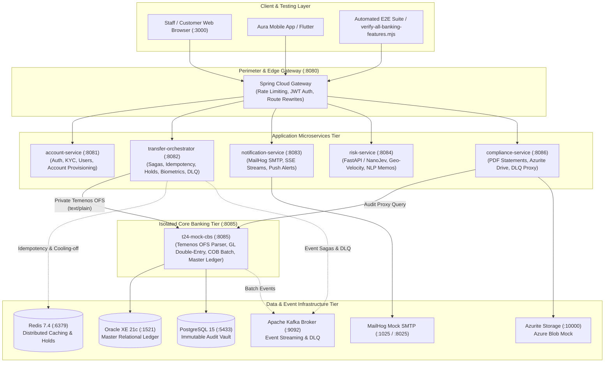
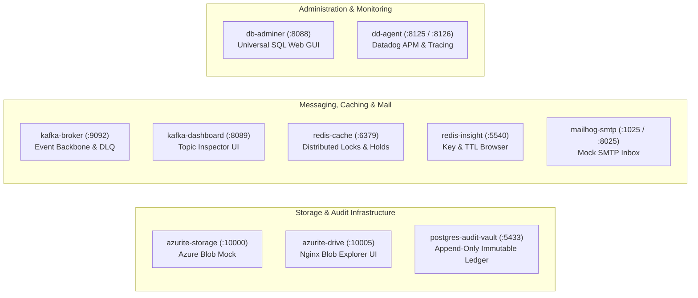

# Supplementary Document 1: Infrastructure Architecture & Network Topology

This document provides a comprehensive technical breakdown of the infrastructure components, service splits, network topology, and perimeter security invariants introduced as part of the Temenos T24 Core Banking System simulation pull request.

---

## 1. System Transition Overview

Prior to commit `9c0d045ccb4d4e52430f34beb6f52baaab2ae189`, the core ledger mutation logic resided in a single service that interacted directly with the database. The new architecture splits business orchestration from the core ledger, introducing a canonical **T24 Mock Core Banking System (CBS)** that acts as the sole custodian of balance mutations and double-entry General Ledger bookkeeping, insulated behind an autonomous **Transfer Orchestrator** and an API Gateway perimeter.

---

## 2. Microservice Responsibilities & Service Splits

The core banking capabilities are segregated into distinct bounded contexts:

| Service Name | Port | Access Type | Primary Responsibility |
| :--- | :--- | :--- | :--- |
| **`gateway-service`** | `8080` | Public Perimeter | Edge security, rate limiting, JWT token verification, dynamic route rewrites, and CORS policy enforcement. |
| **`t24-mock-cbs`** *(Added)* | `8085` | **Internal Only** | **Sole custodian of core banking logic.** Implements the Temenos Open Financial Services (OFS) wire protocol, pessimistic row locking (`SELECT FOR UPDATE`), double-entry General Ledger balancing, and End-Of-Day (EOD/COB) batch processing. |
| **`transfer-orchestrator`** *(Split)* | `8082` | Via Gateway | Autonomous transfer saga coordinator. Handles distributed idempotency via Redis, anti-scam cooling-off holds, FIDO2 biometric step-up challenges, automated saga compensation on downstream failure, and Dead Letter Queue routing. |
| **`account-service`** | `8081` | Via Gateway | Identity and Access Management (IAM), staff role-based access control (RBAC), KYC profile verification queues, device binding, and account provisioning. |
| **`compliance-service`** *(Split)* | `8086` | Via Gateway | PDF statement generation (OpenPDF), Azurite blob operations, and audit log ingestion proxying to the CBS audit vault. |
| **`notification-service`** | `8083` | Via Gateway | Dispatches transactional HTML receipts, login OTP emails, and Server-Sent Events (SSE) notification streams. |
| **`risk-service`** | `8084` | Via Gateway | Python/FastAPI ML engine performing two-stage fraud scoring, impossible geo-velocity travel detection, and AMLA Suspicious Activity Report (SAR/STR) generation. |
| **`banking-frontend`** | `3000` | Public Browser | Unified React 18 back-office portal and the specialized T24 Core Banking Test Console (`/cbs` or `/t24-test`). |

### The Core Banking Zero-Trust Isolation Invariant
In accordance with banking architecture, **`t24-mock-cbs` is never exposed directly to external callers or frontends through the API Gateway**. 

All public funds transfers must pass through the `transfer-orchestrator`, which performs pre-flight checks (authentication, AML risk scoring, idempotency, cooling-off reservations, and biometric step-up verification) before transforming the request into an encrypted Temenos OFS wire string transmitted to `t24-mock-cbs` over the internal Docker network.

---

## 3. New Infrastructure Services Added

To support enterprise banking standards, batch reconciliation, and observability, the following infrastructure services were added to `infrastructure/docker-compose.yml`:

### Detailed Breakdown of Added Infrastructure Services

1. **Azurite Blob Storage (`azurite-storage` - Ports `10000-10002`) & Web Explorer (`azurite-drive` - Port `10005`)**:
   * **Purpose:** Emulates Microsoft Azure Blob Storage locally (`devstoreaccount1` / container `compliance`).
   * **Use Case:** Stores immutable End-Of-Day batch artifacts, GL reconciliation spreadsheets (`.xlsx`), BIR withholding certificates (`.pdf`), and customer bank statements.
   * **UI Explorer:** A custom Nginx-served portal running at `http://localhost:10005` (and embedded in the staff console under `/drive`) allows compliance officers to browse, upload, and inspect regulatory files without external cloud credentials.

2. **MailHog Mock SMTP Server (`mailhog-smtp` - Ports `1025` SMTP, `8025` Web UI)**:
   * **Purpose:** Zero-dependency mock email server.
   * **Use Case:** Intercepts real-time transaction receipts, 2FA login OTP verification codes, and security alerts. Accessible in any browser at `http://localhost:8025`.

3. **Kafka UI Dashboard (`kafka-dashboard` - Port `8089`)**:
   * **Purpose:** Management interface for the local Apache Kafka broker.
   * **Use Case:** Allows developers and QA to inspect in-flight messages on `banking.transfers.events`, verify DLQ incident routing on `banking.transfers.dlq`, and observe batch lifecycle triggers on `banking.batch.events`.

4. **Redis Insight GUI (`redis-insight` - Port `5540`)**:
   * **Purpose:** Visual interface for Redis.
   * **Use Case:** Real-time visibility into distributed idempotency keys (`idemp:*`), session tokens, and the 10-minute anti-scam cooling-off keys (`tx:cooloff:*`) with live countdown timers.

5. **Universal Database Web GUI (`db-adminer` - Port `8088`)**:
   * **Purpose:** Single web-based SQL client connected to both the Oracle XE master database and the PostgreSQL audit vault.
   * **Use Case:** Allows manual inspection of double-entry General Ledger balancing (`gl_ledger`), balance master mutations, and Merkle tree block hashes without installing native desktop database clients.

6. **Datadog Agent (`dd-agent` - Ports `8125` UDP, `8126` TCP)**:
   * **Purpose:** Enterprise APM, distributed tracing, and metric collection agent.
   * **Use Case:** Collects end-to-end trace correlation IDs across microservices (from Gateway to CBS) and emits performance telemetry.

---

## 4. Multi-Author Merge Integration Strategy

Between commit `9c0d045ccb4d4e52430f34beb6f52baaab2ae189` and the final HEAD on `t24-brainstorm`, several pull requests and commits were introduced by other team members (such as mobile UI updates, KYC camera verification, risk engine adjustments, and frontend themes).

### How Non-T24 Changes Were Integrated Without Compromising Functionality

1. **Strict Core Banking Logic Priority:**
   During merge conflict resolution in core services (`application.yml`, `init.sql`, `TransferOrchestrationService.java`, and `T24TestConsole.jsx`), the coworker's verified T24 core banking logic was preserved and given precedence over speculative refactorings.

2. **Preservation of Team Additions:**
   * **Frontend & Mobile UI:** The Flutter mobile application, customer self-service views, and dark/violet themes were preserved without modifying the underlying banking state machines.
   * **Two-Stage Risk Scoring:** The NanoJev/Laya fraud scoring and SAR reporting pipelines from the risk service were retained and called non-blockingly during transfer orchestration.
   * **Device Management & Attestation:** Mobile device registration and 1-web / 2-mobile concurrency limits were preserved in `account-service` while resolving path-matching bugs in Spring MVC routing.

3. **Decoupled Architecture for Future Clearing Extensions:**
   The core T24 banking ledger and saga orchestrator are intentionally architected with clear domain boundaries, allowing future external clearing corridors (such as SWIFT, PhilPaSSplus, or partner networks) to be integrated via dedicated adapters without mutating the core T24 CBS engine.

4. **Continuous Regression Verification:**
   Following every merge commit, the full suite of unit tests across `t24-mock-cbs` and `transfer-orchestrator` was executed alongside the live end-to-end suite (`scripts/verify-all-banking-features.mjs`) to verify that all core positive and negative banking invariants remained operational.
