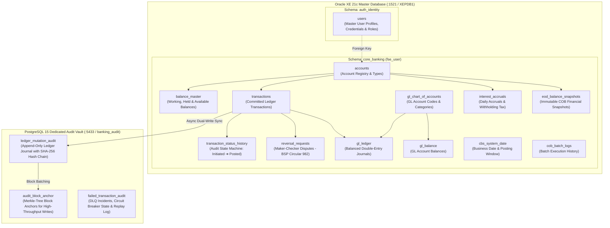
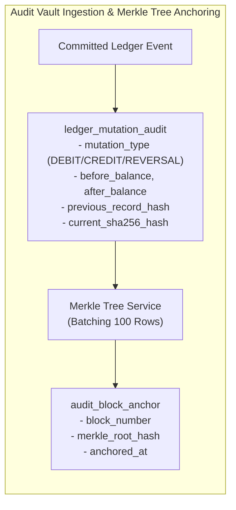

# Supplementary Document 2: Database Schema Design & Security Credentials

This document outlines the dual-database architecture, logical schema groupings, entity relationships, and access credentials implemented across Oracle XE 21c (Master Relational Ledger) and PostgreSQL 15 (Immutable Append-Only Audit Vault).

---

## 1. Dual-Database Architectural Separation

To satisfy enterprise banking audit requirements and maintain transaction processing performance, data storage is divided into two distinct relational engines:

---

## 2. Oracle XE 21c Logical Groupings

The master relational database utilizes logical schemas to enforce separation between identity profiles and financial transaction accounting:

### A. Identity & Access Governance (`auth_identity`)
* **`users`**: Master profile table for Customers, Tellers, Managers, and System Administrators.
  * Fields: `user_id`, `first_name`, `last_name`, `email`, `role` (`CUSTOMER`, `TELLER`, `MANAGER`, `ADMIN`), `password_hash`, `failed_login_attempts`, `status`, `kyc_status`, `last_login_at`, `created_at`, `updated_at`.
  * **Role Guard Invariant**: Restricts mobile client login to `CUSTOMER` while requiring staff to access the web administrative portal.

### B. Core Accounts & Pessimistic Balance Master
* **`accounts`**: Account catalog supporting retail savings and commercial checking accounts (`SAVINGS`, `CHECKING`).
* **`balance_master`**: High-concurrency balance ledger updated under `SELECT FOR UPDATE` row-level locks.
  * Fields: `balance_id` (Surrogate Primary Key), `account_id` (Unique Foreign Key), `balance_amount` (Working Ledger Balance), `hold_amount` (Active Restraints/Holds), `available_balance` (Virtual Generated Column: `balance_amount - hold_amount`).
  * Check Constraint: `CHECK (balance_amount >= hold_amount)` enforces instant solvency at the database engine level.

### C. Transactions & Lifecycle State Machine
* **`transactions`**: Authoritative record of completed financial movements.
  * Standardized format: `TXN-<timestamp>-<hash>`.
  * Fields: `transaction_id`, `from_account_id`, `to_account_id`, `amount`, `currency`, `transaction_type` (`INTRA_BANK`, `INTER_BANK`, `REVERSAL`), `status` (`Initiated`, `Authorized`, `Reserved`, `Processing`, `Posted`, `Reversed`, `Failed`), `before_balance`, `after_balance`, `memo`.
* **`transaction_status_history`**: Chronological progression audit recording each state transition:
  * Sequence: `Initiated` $\rightarrow$ `Authorized` (Biometric Step-Up) $\rightarrow$ `Reserved` (Cooling-off) $\rightarrow$ `Processing` (OFS Parse) $\rightarrow$ `Posted` (Committed).

### D. Double-Entry General Ledger (GL)
Every successful funds transfer writes balanced double-entry accounting records into `gl_ledger`:
* Customer Deposits Liability: `GL-20100` (Customer Demand Deposits).
* Clearing & Settlement Asset: `GL-10200` (Due from Clearing Institutions).
* Bank Fee Income: `GL-4001` (Account Maintenance Fee Revenue).
* Interest Expense: `GL-5001` (Interest Expense on Deposits).
* **Balancing Rule**: $\sum \text{Debit Amount} = \sum \text{Credit Amount}$ for every transaction.

### E. Maker-Checker Reversal Governance (BSP Circular 982)
* **`reversal_requests`**: Dispute tickets initiated by branch tellers.
  * Fields: `ticket_id`, `original_tx_id`, `maker_id`, `checker_id`, `status` (`PENDING`, `APPROVED`, `REJECTED`), `reason`, `reversal_tx_id`, `resolved_at`.
  * **Segregation of Duties Check**: Database constraint and application logic guarantee `checker_id != maker_id`.

### F. Close of Business (COB) & End-Of-Day Ledger State
* **`cbs_system_date`**: Manages current financial business date and posting window status (`ONLINE`, `EOD_CUTOFF`, `OFFLINE`).
* **`interest_accruals`**: Daily interest calculations ($0.5\%$ per annum) based on cleared balance, withholding $20\%$ BIR tax.
* **`eod_balance_snapshots`**: Frozen end-of-day balances used for financial statements and reconciliation.
* **`cob_batch_logs`**: Audit trail of every automated and manual batch execution.

---

## 3. PostgreSQL Dedicated Immutable Audit Vault

To guarantee regulatory compliance (SOX, AMLA, BSP) and prevent ledger tampering, all financial transactions are written to an append-only PostgreSQL database:

1. **`ledger_mutation_audit`**:
   * Append-only table. Updates and deletes are prohibited by database permissions.
   * Every record contains `account_id`, `mutation_type` (`DEBIT`, `CREDIT`, `REVERSAL`), `mutation_amount`, resulting balances, and a SHA-256 cryptographic hash calculated across the row values and the previous row hash.

2. **`audit_block_anchor` (Merkle-Tree Block Anchoring)**:
   * **Scaling Solution**: Instead of forcing every concurrent database thread to lock a single global hash chain (which limits throughput), mutations are grouped into blocks. The `MerkleTreeService` computes a cryptographic Merkle root hash per block and anchors it into `audit_block_anchor`.

3. **`failed_transaction_audit` (Dead Letter Queue Storage)**:
   * Captures failed messages forwarded from Kafka topic `banking.transfers.dlq`.
   * Records `incident_id`, `transaction_id`, `error_type`, `stack_trace`, `circuit_breaker_state`, `replay_status` (`PENDING_REPLAY`, `RESOLVED`), and resolution notes.

---

## 4. Database Access Credentials & Connection Information

| Engine | Host / Port | Service / Database | User | Password | Role / Purpose |
| :--- | :--- | :--- | :--- | :--- | :--- |
| **Oracle XE 21c** | `localhost:1521` | `XEPDB1` | `fse_user` | `fse_password` | Master application connection for microservices. Full read/write over `core_banking` and synonyms. |
| **Oracle XE 21c** | `localhost:1521` | `XEPDB1` | `SYS` | `Password123#` | Database administrator (DBA) for running migrations, table alter scripts, and granting synonyms. |
| **PostgreSQL 15** | `localhost:5433` *(Host)* `5432` *(Container)* | `banking_audit` | `audit_user` | `audit_password` | Dedicated audit vault connection for `t24-mock-cbs` and `compliance-service`. |
| **Adminer Web GUI** | `http://localhost:8088` | Universal | `fse_user` / `audit_user` | Above passwords | Browser-based querying tool for both Oracle XE and PostgreSQL. |
| **Azurite Storage** | `localhost:10000` | `devstoreaccount1` | `devstoreaccount1` | `Eby8vdM02xNOcqFlq...` | Azure Blob Storage access for EOD statements and audit reports. |

---

## 5. Pre-Seeded Test Accounts & Personas Reference

### Core Test Bank Accounts (Oracle XE Master DB)
* **`1000-2000-3001`**: Primary Savings Account (Juan Dela Cruz) — Starting Balance: ₱25,000,000.00
* **`1000-2000-3002`**: Secondary Savings Account (Maria Reyes) — Starting Balance: ₱5,000,000.00
* **`1000-2000-3003`**: Primary Checking Account (Juan Dela Cruz) — Starting Balance: ₱100,000.00
* **`1000-2000-3004`**: Tertiary Savings Account (Branch Pool) — Starting Balance: ₱5,200,000.00
* **`1000-2000-3005`**: Quaternary Savings Account (Branch Reserve) — Starting Balance: ₱3,750,000.00
* **`acc-2002-chk-001`**: Commercial Checking Account — Starting Balance: ₱8,500,000.00

### Staff & Customer Personas
All accounts are pre-seeded with the uniform password: **`password123`**.

| Persona Name | Email | Password | Role | Permissions |
| :--- | :--- | :--- | :--- | :--- |
| **Diana Vance** | `diana.admin@bank.com` | `password123` | `ADMIN` | Full back-office oversight, Checker reversal approval, Customer 360, KYC review queue, Compliance Drive. |
| **Crisostomo Ibarra** | `crisostomo.teller@bank.com` | `password123` | `TELLER` | Branch Operations, Maker reversal ticket filing, Funds Transfer execution. |
| **Carlos Mendoza** | `carlos.teller@bank.com` | `password123` | `MANAGER` | Branch Operations + Reversal Checker authorization. |
| **Juan Dela Cruz** | `juan.dc@email.com` | `password123` | `CUSTOMER` | Retail customer self-service, account and balance enquiry, personal transfer initiation. |

---

## 6. Non-Author Merge Handling for Database Migrations

During development, concurrent schema updates from outside the T24 workstream (such as KYC photo upload tables and device attestation counters) were merged:
* Table modifications (`last_login_at`, `kyc_status`, `device_id`) were incorporated via non-destructive `ALTER TABLE` statements without altering existing constraints.
* The surrogate primary key `balance_id` on `balance_master` and the virtual column `available_balance = balance_amount - hold_amount` were preserved as the source of truth for the core banking engine.
* Multi-schema synonym grants were automated in `infrastructure/oracle/init.sql` so that services accessing tables under the `fse_user` connection could query `users` without schema qualification issues.
