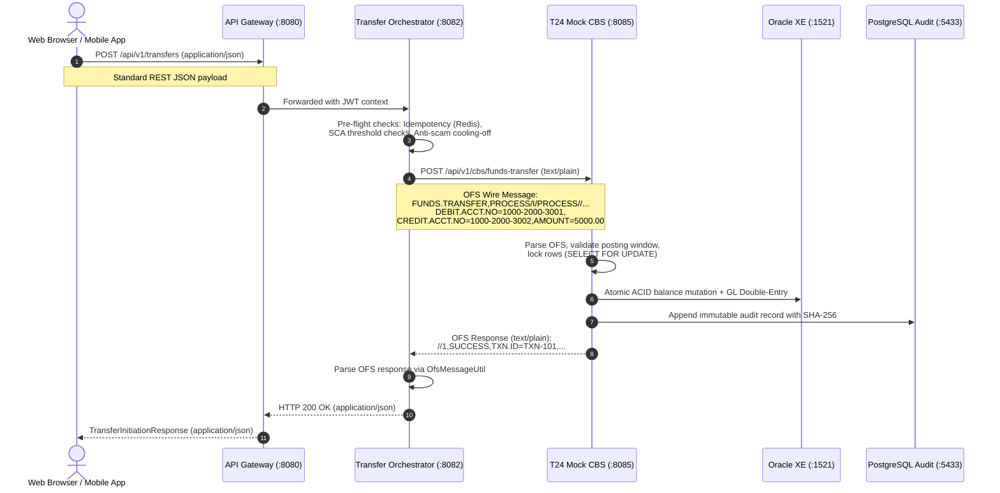

# Supplementary Document 3: API Specifications, Temenos OFS & Gateway Facades

This document details the newly introduced API endpoints, their communication protocols, payload schemas, and the architectural distinction between public REST facades and internal Temenos Open Financial Services (OFS) wire messages.

---

## 1. Architectural Facade Pattern: REST vs. Temenos OFS

In an enterprise Temenos T24 implementation, external applications do not interact directly with core banking tables. Instead, modern client channels communicate with an orchestration tier, which transforms structured JSON into **Temenos Open Financial Services (OFS)** string messages transmitted to the Core Banking System.



---

## 2. API Endpoint Catalog & Facade Mapping

| Category | Public Facade Endpoint | Method | Format | Downstream Internal Endpoint | CBS Internal Format | Primary Purpose |
| :--- | :--- | :---: | :---: | :--- | :---: | :--- |
| **Funds Transfer** | `/api/v1/transfers` | `POST` | JSON | `/api/v1/cbs/funds-transfer` | OFS (`text/plain`) | Executes retail intra-bank transfer with solvency validation. |
| **Biometric Verify**| `/api/v1/transfers/verify-biometric` | `POST` | JSON | `/api/v1/cbs/funds-transfer` | OFS (`text/plain`) | Completes biometric step-up for transfers $\ge$ ₱50k. |
| **Cooling-Off Poll**| `/api/v1/transfers/{id}/cool-off` | `GET` | JSON | *None (Redis Only)* | *N/A* | Polls remaining seconds for transfers $\ge$ ₱250k. |
| **Cooling-Off Cancel**| `/api/v1/transfers/cancel` | `POST` | JSON | *None (Redis Evict)* | *N/A* | Cancels reserved transfer during 10-minute hold. |
| **Maker Dispute** | `/api/v1/reversals/request` | `POST` | JSON | `/api/v1/cbs/reversals/request` | OFS (`text/plain`) | Teller Maker files reversal ticket for review. |
| **Checker Approve** | `/api/v1/reversals/approve` | `POST` | JSON | `/api/v1/cbs/reversals/approve` | OFS (`text/plain`) | Supervisor Checker approves and posts compensating GL. |
| **Direct Reversal** | `/api/v1/reversals/direct` | `POST` | JSON | `/api/v1/cbs/reversal` | OFS (`text/plain`) | Machine-to-machine automated saga rollback. |
| **Reversal Queue** | `/api/v1/reversals` | `GET` | JSON | `/api/v1/cbs/reversals` | OFS (`text/plain`) | Lists pending maker-checker reversal tickets. |
| **Txn History** | `/api/v1/transfers/accounts/{id}/transactions` | `GET` | JSON | `/api/v1/cbs/accounts/{id}/transactions` | OFS (`text/plain`) | Queries committed account ledger transactions (`ENQUIRY.SELECT`). |
| **Status History** | `/api/v1/transfers/transactions/{id}/status-history` | `GET` | JSON | `/api/v1/cbs/transactions/{id}/status-history` | OFS (`text/plain`) | Retrieves 4-stage audit history for a transaction. |
| **Outward Wire** | `/api/v1/interbank/transfers/outward` | `POST` | JSON | Internal Wire Client $\rightarrow$ Partner Bank B | JSON / Wire | Debits sender, credits Nostro buffer, calls Partner Bank. |
| **Inward Wire** | `/api/v1/interbank/transfers/inward` | `POST` | JSON | `/api/v1/cbs/funds-transfer` | OFS (`text/plain`) | Ingests incoming wire from Partner Bank B (`X-Interbank-API-Key`). |
| **System Date** | `/api/v1/cbs/system-date` | `GET` | OFS | Native CBS Endpoint | OFS (`text/plain`) | Returns banking business date and posting window status. |
| **COB Run** | `/api/v1/cbs/cob/run` | `POST` | OFS | Native CBS Endpoint | OFS (`text/plain`) | Executes Close-of-Business EOD batch processing. |
| **DLQ Incidents** | `/api/v1/cbs/audit/failed-transactions` | `GET` | JSON | Native CBS Endpoint | JSON | Queries dead-lettered failure incidents from PostgreSQL. |
| **DLQ Resolve** | `/api/v1/cbs/audit/failed-transactions/{id}/resolve` | `POST` | JSON | Native CBS Endpoint | JSON | Marks DLQ incident resolved with operator audit notes. |

---

## 3. Detailed Request & Response Specifications

### A. Retail Funds Transfer Facade
* **Endpoint:** `POST /api/v1/transfers`
* **Handling Service:** `transfer-orchestrator` $\rightarrow$ calls `t24-mock-cbs`
* **Headers:** `Content-Type: application/json`, `Authorization: Bearer <JWT>`
* **Request Schema (`TransferInitiationRequest`):**
  ```json
  {
    "transactionId": "TXN-FT-POS-1001",
    "sourceAccountId": "1000-2000-3001",
    "destinationAccountId": "1000-2000-3002",
    "amount": 5000.00,
    "currency": "PHP",
    "description": "Standard transfer via Gateway",
    "idempotencyKey": "IDEMP-TXN-1001",
    "deviceId": "DEVICE-PC-01"
  }
  ```
* **Success Response Schema (`TransferInitiationResponse` - HTTP 200 OK):**
  ```json
  {
    "transactionId": "TXN-FT-POS-1001",
    "status": "Posted",
    "message": "Transfer executed successfully on CBS core",
    "amount": 5000.00,
    "sourceAccountId": "1000-2000-3001",
    "destinationAccountId": "1000-2000-3002",
    "biometricRequired": false,
    "coolingOffRequired": false
  }
  ```
* **Downstream Temenos OFS Format (`POST /api/v1/cbs/funds-transfer`):**
  ```text
  FUNDS.TRANSFER,PROCESS/I/PROCESS//,DEBIT.ACCT.NO=1000-2000-3001,CREDIT.ACCT.NO=1000-2000-3002,DEBIT.AMOUNT=5000.00,DEBIT.CURRENCY=PHP,PAYMENT.DETAILS=Standard transfer via Gateway,TRANSACTION.ID=TXN-FT-POS-1001
  ```

---

### B. Anti-Scam Cooling-Off Reservation Facade
* When `amount >= 250000.00`, the orchestrator reserves the transfer in Redis for 10 minutes without writing to the CBS core.
* **Response Schema (HTTP 200 OK):**
  ```json
  {
    "transactionId": "TXN-COOL-3001",
    "status": "Reserved",
    "message": "COOLING_OFF_PERIOD_INITIATED: High-value transaction locked for 10 minutes to protect against fraud.",
    "amount": 300000.00,
    "coolingOffRequired": true,
    "coolingOffExpiresInSeconds": 600
  }
  ```
* **Poll Endpoint:** `GET /api/v1/transfers/{transactionId}/cool-off`
  ```json
  {
    "transactionId": "TXN-COOL-3001",
    "isCoolingOff": true,
    "remainingSeconds": 584
  }
  ```
* **Cancel Endpoint:** `POST /api/v1/transfers/cancel` with body `{"transactionId": "TXN-COOL-3001"}`
  ```json
  {
    "transactionId": "TXN-COOL-3001",
    "cancelled": true,
    "message": "Transfer cancelled successfully during cooling-off window."
  }
  ```

---

### C. Strong Customer Authentication (SCA) Biometric Step-Up
* When `amount >= 50000.00` and no cryptographic assertion is provided, a challenge is issued.
* **Challenge Response Schema (HTTP 200 OK):**
  ```json
  {
    "transactionId": "TXN-BIO-5001",
    "status": "Authorized",
    "message": "BIOMETRIC_CHALLENGE_REQUIRED: Device biometric verification required for transaction.",
    "biometricRequired": true,
    "biometricChallenge": "CHALLENGE-TOKEN-9f82d1c"
  }
  ```
* **Verification Endpoint:** `POST /api/v1/transfers/verify-biometric`
  ```json
  {
    "transactionId": "TXN-BIO-5001",
    "challengeToken": "CHALLENGE-TOKEN-9f82d1c",
    "assertionSignature": "VALID_MOCK_ASSERTION_SIGNATURE",
    "sourceAccountId": "1000-2000-3001",
    "destinationAccountId": "1000-2000-3002",
    "amount": 75000.00
  }
  ```

---

### D. Maker-Checker Dual-Control Reversal Facade (BSP Circular 982)
* **Maker Ticket Filing:** `POST /api/v1/reversals/request`
  * **Payload:**
    ```json
    {
      "originalTransactionId": "TXN-FT-POS-1001",
      "makerId": "usr-1003-tel-001",
      "reason": "CUSTOMER_DISPUTE",
      "notes": "Typo by branch teller"
    }
    ```
  * **Response:**
    ```json
    {
      "ticketId": "12340ec4-5c35-4637-afdb-bb352f1ee658",
      "status": "PENDING",
      "message": "Reversal ticket created. Awaiting checker approval."
    }
    ```
* **Checker Approval:** `POST /api/v1/reversals/approve`
  * **Payload:**
    ```json
    {
      "ticketId": "12340ec4-5c35-4637-afdb-bb352f1ee658",
      "checkerId": "usr-1004-adm-001"
    }
    ```
  * **Response:**
    ```json
    {
      "ticketId": "12340ec4-5c35-4637-afdb-bb352f1ee658",
      "status": "APPROVED",
      "reversalTransactionId": "REV-TXN-998811",
      "message": "Reversal approved and compensating GL entries committed."
    }
    ```
  * **Dual Control Violation Handling:** If `checkerId == makerId`, the API rejects with `HTTP 400 Bad Request`:
    `"Dual control violation: Checker cannot be the same person as Maker (usr-1003-tel-001) (BSP Circular 982)"`

---

### E. Bilateral Nostro-Vostro Interbank Corridor
* **Outward Wire (AuraBank $\rightarrow$ Partner Bank B):** `POST /api/v1/interbank/transfers/outward`
  * **Payload:**
    ```json
    {
      "sourceAccountId": "1000-2000-3001",
      "destinationAccountId": "B-ACC-778899",
      "destinationBank": "BANK-B",
      "senderName": "Juan Dela Cruz",
      "amount": 500.00,
      "currency": "PHP"
    }
    ```
  * **Mechanism:** Debits sender `1000-2000-3001` and credits Nostro buffer `ACC-NOSTRO-BANK-B`. If partner times out, an **automated Saga rollback** refunds the customer immediately (`HTTP 502 Bad Gateway`).
* **Inward Wire (Partner Bank B $\rightarrow$ AuraBank):** `POST /api/v1/interbank/transfers/inward`
  * **Security Header:** `X-Interbank-API-Key: aura-bank-interbank-secure-key-2026`
  * **Payload:**
    ```json
    {
      "senderAccountId": "B-ACC-778899",
      "beneficiaryAccountId": "acc-2002-chk-001",
      "sourceBank": "BANK-B",
      "senderName": "Partner Client B",
      "amount": 2500.00,
      "currency": "PHP",
      "partnerReference": "B-TXN-EXT-1092"
    }
    ```
  * **Response:** `HTTP 200 OK` with `status: "SETTLED"`, crediting beneficiary `acc-2002-chk-001`.

---

## 4. Third-Party Code Integration & Routing Precedence

During merge integration with other branches, two critical API routing issues were identified and resolved:
1. **Spring MVC Route Matching in `KycController.java`**:
   The parameterized endpoint `@GetMapping("/{userId}")` had been declared above `@GetMapping("/reviews")`, causing Spring MVC to interpret `/api/v1/kyc/reviews` as user ID `"reviews"`. Reordering `@GetMapping("/reviews")` before `/{userId}` restored administrative review access.
2. **Device Type Resolution in `AuthService.java`**:
   Administrative logins (`diana.admin@bank.com`) require explicit identification as `WEB` portal clients. Supplying device metadata guarantees that the system enforces the 1-web / 2-mobile device limits without blocking legitimate back-office administrators.
