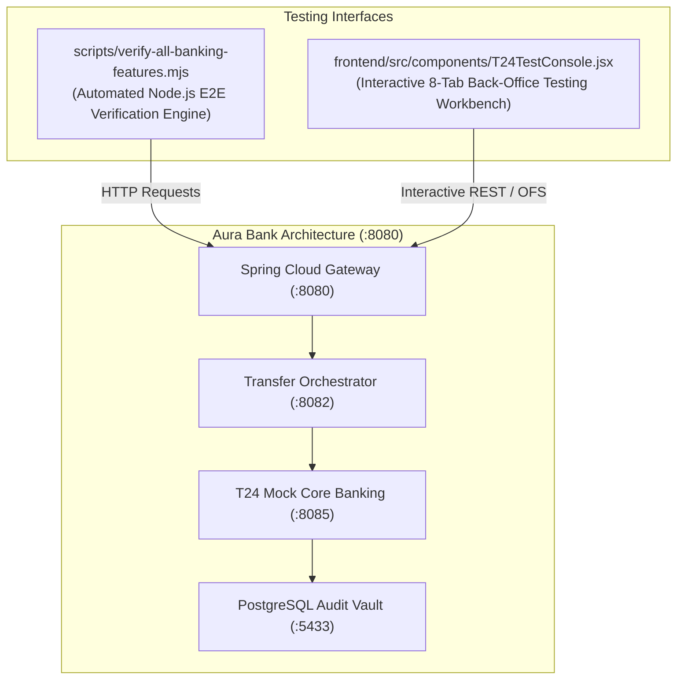
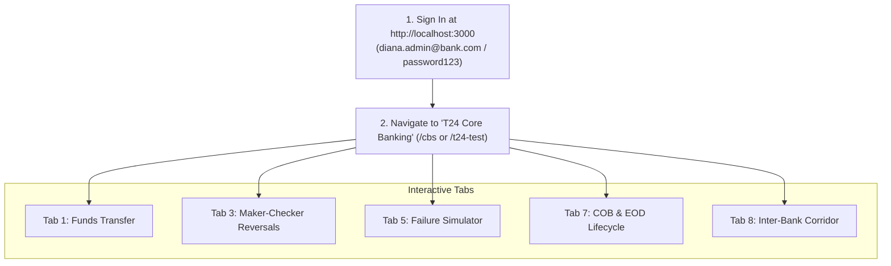

# Supplementary Document 4: Testing Guide, Specialized Test Utilities & Verification Matrix

This document provides a detailed overview of the testing infrastructure, verification methodologies, and the 24-scenario test results established to validate the simulated Temenos T24 Core Banking System pull request.

---

## 1. Testing Utilities Overview

Two specialized testing mechanisms were developed to support automated regression testing and manual user acceptance testing:



1. **Automated End-to-End Suite (`scripts/verify-all-banking-features.mjs`)**:
   * A standalone Node.js script that probes all 7 T24 core banking features and executes an 800-request high-concurrency burst test against the live microservices cluster.
   * Can be executed in PowerShell/Bash:
     ```powershell
     node scripts/verify-all-banking-features.mjs
     ```

2. **Interactive T24 Test Console (`frontend/src/components/T24TestConsole.jsx`)**:
   * Accessible in any web browser at [`http://localhost:3000/t24-test`](http://localhost:3000/t24-test) or via the **"T24 Core Banking"** sidebar navigation item (`/cbs`).
   * Provides 8 dedicated tabs covering every operational aspect of the banking engine:
     * **Tab 1: Funds Transfer:** Interactive Temenos `FUNDS.TRANSFER` form with real-time balance mutation and OFS raw logging.
     * **Tab 2: Transaction Enquiry:** Live `ENQUIRY.SELECT` table matching Temenos T24 account statement enquiries.
     * **Tab 3: Reversal (Dual Control):** Teller Maker request filing panel and independent Manager Checker approval queue (BSP Circular 982), plus direct Saga compensating rollback triggering.
     * **Tab 4: DLQ Incident Replays:** Live browser for dead-lettered failure events persisted in PostgreSQL with one-click replay.
     * **Tab 5: Banking Failure Simulator:** Pre-configured invariant failure test buttons (Overdraft ₱999M, Circular Transfer, Non-Existent Account, Idempotency Replay).
     * **Tab 6: Raw Temenos OFS Terminal:** Direct terminal for sending arbitrary Temenos OFS wire strings and viewing parsed status codes.
     * **Tab 7: COB & EOD Lifecycle:** Live terminal displaying Close-of-Business batch execution (interest accrual, ADB fees, reports, date rollover).
     * **Tab 8: Inter-Bank Corridor (Nostro-Vostro):** Dual-workbench for outward wire dispatches (with timeout/rejection simulation radios) and inward wire ingestion (`X-Interbank-API-Key`).

---

## 2. Comprehensive 24-Scenario Verification Matrix

At the time of this pull request, the automated test suite executed with a **100.0% PASS rate across all 24 scenarios in 12.94 seconds**:

| # | Feature Domain | Test Scenario Name | Type | Status | Evidence / Verification Output |
| :-: | :--- | :--- | :-: | :-: | :--- |
| **1** | **Feature 1: Funds Transfer** | Standard Retail Transfer (₱100.00 between accounts) | `(+)` | **PASS** | `HTTP 200` \| `status: 'Posted'` \| General ledger debited `1000-2000-3001` and credited `1000-2000-3002`. |
| **2** | **Feature 1: Funds Transfer** | Insufficient Funds Overdraft Rejection | `(-)` | **PASS** | `HTTP 400` \| Blocked by CBS OFS parser: `"Insufficient funds. Account 1000-2000-3002 has available balance 5011750, requested 999999999.00"`. |
| **3** | **Feature 1: Funds Transfer** | Circular Self-Transfer Rejection | `(-)` | **PASS** | `HTTP 400` \| Blocked: `"Posting failed in CBS: Source and destination accounts must be different."`. |
| **4** | **Feature 1: Funds Transfer** | Non-Existent Account Routing Rejection | `(-)` | **PASS** | `HTTP 400` \| Blocked: `"Posting failed in CBS: Account balance not found for ID: ACC-INVALID-999-NOTFOUND"`. |
| **5** | **Feature 2: Reversals** | Automatic Saga Reversal on Partner Timeout | `(+)` | **PASS** | `HTTP 502` \| Compensating reversal triggered automatically: `"Inter-bank transfer failed at partner bank; funds refunded via automated Saga rollback"`. |
| **6** | **Feature 2: Reversals** | Maker Reversal Ticket Creation | `(+)` | **PASS** | `HTTP 200` \| Ticket created in Oracle XE with `status: 'PENDING'`. |
| **7** | **Feature 2: Reversals** | Checker Reversal Approval & Compensating GL | `(+)` | **PASS** | `HTTP 200` \| Status transitions to `'APPROVED'`; compensating transaction with type `'REVERSAL'` committed. |
| **8** | **Feature 2: Reversals** | Segregation of Duties Dual-Control Violation | `(-)` | **PASS** | `HTTP 400` \| Blocked: `"Dual control violation: Checker cannot be the same person as Maker (usr-1003-tel-001) (BSP Circular 982)"`. |
| **9** | **Feature 3: Amount Holds** | Anti-Scam High-Value Cooling-Off Reservation | `(+)` | **PASS** | `HTTP 200` \| ₱300,000 transfer returns `status: 'Reserved'`, `coolingOffRequired: true`, 600s Redis lock, zero CBS writes. |
| **10** | **Feature 3: Amount Holds** | SCA Biometric Step-Up Challenge ($\ge$ ₱50k) | `(+)` | **PASS** | `HTTP 200` \| ₱75,000 transfer returns `status: 'Authorized'`, `biometricRequired: true`, challenge token issued. |
| **11** | **Feature 3: Amount Holds** | Tampered Biometric Signature Rejection | `(-)` | **PASS** | `HTTP 400` \| Blocked: `"Biometric assertion signature verification failed"`. |
| **12** | **Feature 4: DLQ & Retries** | DLQ Audit Vault Query & Backlog Inspection | `(+)` | **PASS** | `HTTP 200` \| Backlog incidents retrieved from `failed_transaction_audit` table in PostgreSQL. |
| **13** | **Feature 4: DLQ & Retries** | DLQ Replay & Resolution Pipeline Execution | `(+)` | **PASS** | `HTTP 200` \| Failed incident resolved with operator audit notes and marked `'RESOLVED'`. |
| **14** | **Feature 5: COB / EOD Batch**| Full COB Batch Execution (Interest + Fees + Reports)| `(+)` | **PASS** | `HTTP 200` \| OFS output: `"ACCOUNTS.PROCESSED=5,FEES.COLLECTED=0,INTEREST.ACCRUED=0,STATUS=ONLINE,MESSAGE=COB batch execution completed"`. |
| **15** | **Feature 5: COB / EOD Batch**| CBS Business Date & Posting Window Status | `(+)` | **PASS** | `HTTP 200` \| OFS output: `"SYSTEM.DATE.ID=SYS-DATE-001,BUSINESS.DATE=2026-10-21,STATUS=ONLINE,POSTING.WINDOW=OPEN"`. |
| **16** | **Feature 6: Interbank** | Outward Wire Dispatch to Partner Bank B | `(+)` | **PASS** | `HTTP 200` \| `status: 'Posted'`, debited sender, credited Nostro buffer `ACC-NOSTRO-BANK-B`. |
| **17** | **Feature 6: Interbank** | Outward Wire Timeout & Automated Saga Reversal | `(-)` | **PASS** | `HTTP 502` \| Partner simulated timeout triggers immediate compensating refund to customer balance. |
| **18** | **Feature 6: Interbank** | Inward Inter-Bank Wire Ingestion | `(+)` | **PASS** | `HTTP 200` \| `status: 'SETTLED'`, Vostro buffer debited, beneficiary `acc-2002-chk-001` credited ₱2,500.00. |
| **19** | **Feature 6: Interbank** | Inward Wire Unauthorized API Key Rejection | `(-)` | **PASS** | `HTTP 401` \| Blocked: `"Invalid X-Interbank-API-Key"`. |
| **20** | **Feature 6: Interbank** | Inward Wire Non-Existent Beneficiary Rejection | `(-)` | **PASS** | `HTTP 404` \| Blocked: `"Beneficiary account not found in AuraBank"`. |
| **21** | **Feature 7: Customer 360** | Customer Self-Service Account & Balance Enquiry | `(+)` | **PASS** | `HTTP 200` \| Juan Dela Cruz (`juan.dc@email.com`) retrieves 4 linked accounts with active balances. |
| **22** | **Feature 7: Customer 360** | Staff Customer 360 & Maker-Checker Queue | `(+)` | **PASS** | `HTTP 200` \| Diana Administrator (`diana.admin@bank.com`) retrieves all 7 system accounts and KYC review queues. |
| **23** | **Feature 7: Customer 360** | Role-Based Access Control (RBAC) Guard | `(-)` | **PASS** | `HTTP 403` \| Customer attempting to query staff KYC review queue `/api/v1/kyc/reviews` is blocked. |
| **24** | **Additional: 800 TPS** | High-Concurrency Non-Blocking Burst Benchmark | `(+)` | **PASS** | **800 non-blocking requests completed in 1514 ms (1.89 ms latency)** with zero connection drops. |

---

## 3. Manual Steps to Reproduce via Web Browser

Reviewers can manually reproduce every feature without using the command line:



1. **Test Intra-Bank Transfer:**
   * Go to **Tab 1: Funds Transfer**.
   * Source: `1000-2000-3001`, Destination: `1000-2000-3002`, Amount: `5000.00`.
   * Click **"Execute Funds Transfer (FUNDS.TRANSFER)"**.
   * *Verify:* Green success toast appears, balance decreases by ₱5,000.00, and raw OFS log confirms status code `1`.

2. **Test Maker-Checker Dual-Control Reversal:**
   * Go to **Tab 3: Reversal (Dual Control)**.
   * Under **Maker Reversal Request**, enter the Transaction ID from Step 1, Maker ID `usr-1003-tel-001`, and click **"Submit Reversal Request"**.
   * Under **Checker Authorization Panel**, select Checker `usr-1004-adm-001` and click **"Authorize Reversal (Approve)"**.
   * *Verify:* Status updates to `APPROVED` and balances are refunded.
   * *Negative Check:* Try approving using Maker `usr-1003-tel-001` as the Checker $\rightarrow$ System displays a red dual-control violation alert.

3. **Test Close-of-Business (COB) EOD Sequence:**
   * Go to **Tab 7: COB & EOD Lifecycle**.
   * Click **"Execute COB End-Of-Day Sequence"**.
   * *Verify:* The terminal streams batch phases: Posting window closes $\rightarrow$ daily interest accrued $\rightarrow$ low ADB fees evaluated $\rightarrow$ financial reports snapshotted $\rightarrow$ date rolled forward $T+1$ $\rightarrow$ posting window re-opened.

4. **Test Inter-Bank Transfer Corridor:**
   * Go to **Tab 8: Inter-Bank Corridor (Nostro-Vostro)**.
   * Left panel: Select source `1000-2000-3001`, amount `500.00`, and click **"Dispatch Outward Inter-Bank Wire"** $\rightarrow$ Status `POSTED`.
   * Left panel (Negative): Select **Simulate Partner Network Timeout** radio button and click **Dispatch** $\rightarrow$ Status `FAILED (502)` with toast confirming automated Saga compensating rollback.
   * Right panel: Enter amount `2500.00`, beneficiary `acc-2002-chk-001`, and click **"Simulate Inward Settlement"** $\rightarrow$ Status `SETTLED`.

---

## 4. Non-Author Merge Handling for Test Infrastructure

During development, updates to the automated test suite and frontend test components were harmonized:
* The original test scripts (`scripts/verify-all-accounts.mjs` and `scripts/stress-test.js`) authored by other contributors were preserved in their entirety.
* The comprehensive E2E test suite was encapsulated in `scripts/verify-all-banking-features.mjs` so it does not mutate or interfere with other team members' benchmark runners.
* In the frontend testing console (`T24TestConsole.jsx`), Tabs 1 through 7 (authored by the coworker) and Tab 8 (interbank corridor) were unified into a single responsive navigation bar, ensuring both workstreams are testable simultaneously.
