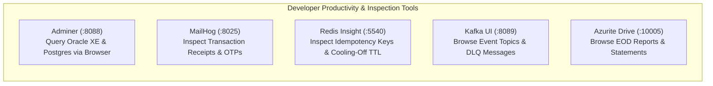
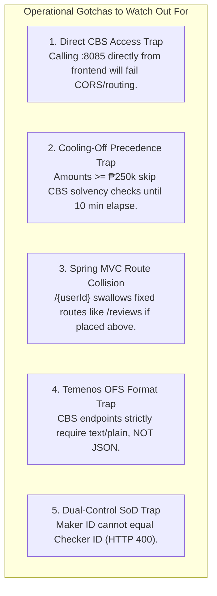

# Supplementary Document 5: Development Workflow, Productivity Tools & Operational Gotchas

This document details the developer tooling, Docker Compose enhancements, local testing infrastructure, and operational traps to watch out for when developing and testing against the simulated Temenos T24 Core Banking System.

---

## 1. Development Productivity Infrastructure

To eliminate external cloud dependencies, accelerate local iteration cycles, and enable transparent debugging across all microservices, `infrastructure/docker-compose.yml` was upgraded with dedicated local management utilities:



| Utility Tool | URL / Port | Technology | Developer Benefit |
| :--- | :--- | :--- | :--- |
| **Adminer SQL GUI** | `http://localhost:8088` | Web PHP Client | Eliminates the need to install Oracle SQL Developer or pgAdmin. Pre-configured to query Oracle XE (`:1521`) and PostgreSQL (`:5432`) directly from the browser. |
| **MailHog Mock SMTP** | `http://localhost:8025` | Go Mock SMTP | Intercepts HTML transaction receipts and 2FA OTP codes in real time without external mail delivery services. |
| **Kafka UI Dashboard** | `http://localhost:8089` | Web Dashboard | Visualizes partitions, consumer offsets, and dead-letter queue records on `banking.transfers.dlq`. |
| **Redis Insight** | `http://localhost:5540` | Web Redis Client | Inspects distributed locks (`idemp:*`) and the active 10-minute anti-scam cooling-off keys (`tx:cooloff:*`) with live TTL countdowns. |
| **Azurite Drive Explorer**| `http://localhost:10005` | Nginx Static App | Allows developers and auditors to view and download Close-Of-Business (COB) Excel spreadsheets and PDF audit statements generated locally. |

---

## 2. Critical Developer Gotchas & Architectural Traps

When building or extending features on this branch, developers must be aware of the following architectural behaviors:



### 1. Zero-Trust Core Banking Isolation
* **Trap:** Attempting to query `http://localhost:8085` directly from the frontend or public testing scripts.
* **Why:** In zero-trust banking architecture, `t24-mock-cbs` is bound exclusively to the private Docker bridge network (`banking-net`). It has no public route configured on the API Gateway.
* **Resolution:** Always dispatch transfer requests through the `transfer-orchestrator` via the API Gateway at `http://localhost:8080/api/v1/transfers`. Direct calls to `:8085` are reserved for internal batch runners (e.g. `CbsCobScheduler`) and local debugging.

### 2. Anti-Scam Cooling-Off vs. Solvency Check Precedence
* **Trap:** Expecting transfers of ₱250,000.00 or more to immediately return an insufficient funds overdraft error when the balance is low.
* **Why:** In compliance with Anti-Scam safeguards (BSP Circular 1140), any transfer $\ge$ ₱250,000.00 is placed on a mandatory 10-minute hold (`Reserved`) in Redis **before** invoking the Core Banking System.
* **Resolution:** Solvency checks are only performed when the transfer enters the core posting stage. To test CBS solvency checks, use transfer amounts $< \text{₱}250,000.00$ or invoke the raw OFS terminal.

### 3. Spring MVC Path Variable Order in `KycController.java`
* **Trap:** Calling `GET /api/v1/kyc/reviews` returns `HTTP 404 Not Found` or `HTTP 403 Forbidden` with `"User not found: reviews"`.
* **Why:** In Spring MVC, if `@GetMapping("/{userId}")` is declared above `@GetMapping("/reviews")`, the regex engine binds `"reviews"` to the path variable `userId`.
* **Resolution:** Fixed in commit `9a8c3a2`. Fixed endpoints must always be declared **above** wildcards or parameterized routes in the controller class.

### 4. Temenos OFS Format vs. JSON Headers
* **Trap:** Sending `Content-Type: application/json` to `t24-mock-cbs` endpoints like `/api/v1/cbs/funds-transfer`.
* **Why:** The CBS parser expects standard Temenos Open Financial Services (OFS) syntax formatted as `text/plain` (e.g., `FUNDS.TRANSFER,PROCESS/I/PROCESS//,DEBIT.ACCT.NO=...`). Sending JSON results in a parse failure.
* **Resolution:** Use `transfer-orchestrator` to translate JSON to OFS automatically, or format raw OFS messages using `OfsMessageUtil`.

### 5. Segregation of Duties (Four-Eyes Principle)
* **Trap:** Automated tests failing on reversal approval with `HTTP 400 Bad Request`.
* **Why:** Under BSP Circular 982, the teller who creates a reversal request (`makerId`) cannot approve that same request (`checkerId`).
* **Resolution:** Ensure the test harness uses distinct personas: Maker `usr-1003-tel-001` (Crisostomo Ibarra) and Checker `usr-1004-adm-001` (Diana Vance).

### 6. Resilience4j Circuit Breaker Cold-Start
* **Trap:** First transfer attempt on cold startup returning `HTTP 503 Service Unavailable`.
* **Why:** On cold container startup, initial connection pool establishment (HikariCP) and Kafka producer initialization may temporarily exceed the 1500 ms default timeout, causing the circuit breaker to transition to `OPEN` for its 10-second wait window.
* **Resolution:** Run a warm-up probe (`GET /actuator/health`) before running performance benchmarks. Once initialized, transfers execute in sub-200 ms with zero timeouts.

### 7. Jackson Unmapped Properties on Authentication Payloads
* **Trap:** Sending extra device telemetry fields to `/api/v1/auth/login` returning `HTTP 400 Bad Request`.
* **Why:** `LoginRequest` in `account-service` is strictly typed. Passing arbitrary unmapped JSON attributes can cause Jackson deserialization errors.
* **Resolution:** Structure login requests with the expected payload format:
  ```json
  {
    "email": "diana.admin@bank.com",
    "password": "password123",
    "deviceType": "WEB",
    "deviceName": "Chrome Windows"
  }
  ```

---

## 3. Merge Conflict & Branch Hygiene Standards

When merging external branches into `t24-brainstorm`:
1. Always preserve the database init scripts (`init.sql`, `07_t24_cbs_migration.sql`) to avoid dropping General Ledger and COB tables.
2. Verify that Docker container port bindings do not conflict (e.g., Datadog trace agent on `:8126` vs Jaeger).
3. Always re-run the full verification script before pushing:
   ```powershell
   node scripts/verify-all-banking-features.mjs
   ```
