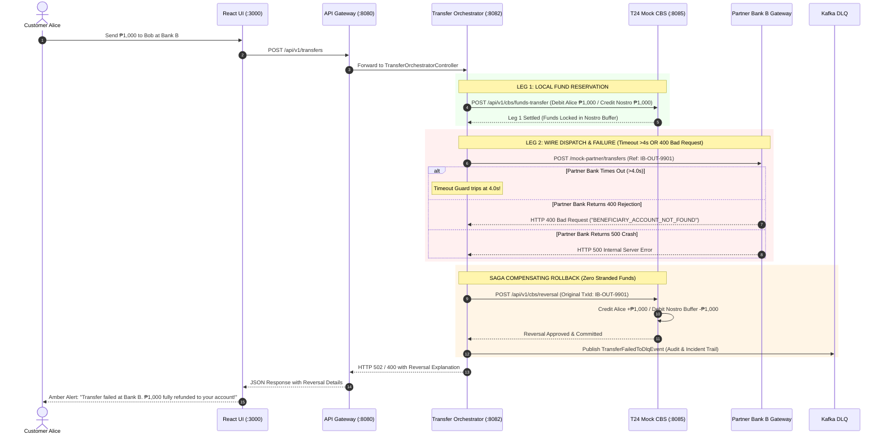

# Implementation Plan: Interbank Transfers via Existing Endpoints, Core Isolation & Failure Resilience

## Architectural Feasibility & Direct Answers

### 1. Is there a way to do this without adding new endpoints to the T24 Mock CBS?
**Yes, absolutely.** In enterprise banking architecture, a Core Banking System (like Temenos T24) is strictly an internal ledger custodian. It has no awareness of external bank networks, ISO 20022 clearing rails, SWIFT gateways, or partner APIs. Interbank settlement is booked as standard internal double-entry accounting against an internal **Bilateral Nostro/Vostro Buffer Account** (`ACC-NOSTRO-BANK-B`).

T24 Mock CBS requires **zero new endpoints**. All interbank transactions are processed via its existing canonical endpoints:
1. **`POST /api/v1/cbs/funds-transfer`** (Temenos OFS `FUNDS.TRANSFER`):
   - **Outward Leg 1**: Debits customer account, credits `ACC-NOSTRO-BANK-B`.
   - **Inward Leg 3**: Debits `ACC-NOSTRO-BANK-B`, credits beneficiary customer account.
2. **`POST /api/v1/cbs/reversal`** (Temenos OFS `FUNDS.TRANSFER,REVERSE`):
   - **Compensating Saga Reversal**: Reverses Leg 1 if external partner bank wire fails or times out.
3. **`GET /api/v1/cbs/accounts/{accountId}/balance`** (Temenos OFS `BALANCE.ENQUIRY`):
   - **Pre-flight Beneficiary Verification**: Validates account existence before booking inward wire.

---

### 2. Can we ensure interbank communication does NOT go into Mock T24 CBS directly?
**Yes, 100%. This is the Core Banking Zero-Trust Isolation Invariant.**
External systems (partner banks, clearing switches, mobile clients, and web browsers) must **never** send traffic directly to `t24-mock-cbs` (`:8085`):
- `t24-mock-cbs` operates exclusively on raw Temenos OFS text syntax (`text/plain`), lacks partner API key authentication, lacks JWT verification, and has no fraud/AML screening.
- All external traffic terminates at **Spring Cloud Gateway** (`:8080`) and **Transfer Orchestrator** (`:8082`).
- Only `Transfer Orchestrator` (inside the private backend network) translates business requests into internal OFS messages and calls `t24-mock-cbs`.
- External partner banks communicate **only** through the API Gateway perimeter.

---

## Comprehensive Failure Modes & Resilience Engineering Matrix

Below is the complete taxonomy of how an interbank transfer can fail, with special emphasis on **Partner Bank Side Failures**, and how our architecture guarantees ledger consistency:

### Category 1: Failures on the Partner Bank Side (Outward Wire: AuraBank $\to$ Bank B)

| Failure Scenario | Root Cause at Partner Bank | HTTP / Wire Signal | Architectural Handling & Saga Compensation | Customer Impact & Recovery |
| :--- | :--- | :--- | :--- | :--- |
| **1. Invalid Beneficiary Account** | Recipient account number does not exist at Partner Bank B | Partner returns `HTTP 400 Bad Request` or `HTTP 422` (`BENEFICIARY_ACCOUNT_NOT_FOUND`) | Orchestrator catches 4xx. Executes **CBS Compensating Reversal** (`POST /api/v1/cbs/reversal`). Emits status to Kafka. | **Immediate 100% refund.** UI displays: *"Transfer rejected by Bank B: Beneficiary account invalid. Funds returned to your account."* |
| **2. Beneficiary Account Frozen / Dormant** | Recipient account is locked due to AML, sanctions, court freeze, or dormancy | Partner returns `HTTP 422 Unprocessable` (`ACCOUNT_BLOCKED` or `ACCOUNT_DORMANT`) | Orchestrator catches rejection. Executes **CBS Compensating Reversal**. Debits Nostro buffer, credits Alice. | **Immediate 100% refund.** UI displays: *"Partner bank cannot accept funds for this beneficiary account."* |
| **3. Partner Bank Gateway Timeout (> 4.0s)** | Partner bank is experiencing high load, DB deadlocks, or network latency | Client timeout guard trips at **4.0 seconds** (`TimeoutException`) | `InterbankWireClient` trips timeout guard. Immediately calls **CBS Compensating Reversal**. Publishes `TransferFailedToDlqEvent` to Kafka topic `banking.transfers.dlq`. | **Immediate 100% refund.** UI displays: *"Partner bank timed out; transaction canceled and funds refunded."* |
| **4. The "In-Doubt" Dual-Write Edge Case** | Partner bank credits beneficiary at 4.1s, but network ACK dropped right after timeout | Network disconnect / packet drop | Partner bank uses **idempotent deduplication** on `referenceId` (`txId`). Kafka DLQ records incident. End-of-Day (EOD) Nostro reconciliation resolves bilateral variance. | Zero double-crediting. Ledger auditable via Merkle audit trail. |
| **5. Partner Bank Core Crash (5xx)** | Partner Bank's database or core service crashes | Partner returns `HTTP 500 Internal Server Error` or `503 Unavailable` | Caught as server error. Executes **CBS Compensating Reversal** refunding Alice. Incident routed to DLQ. | **Immediate 100% refund.** Customer sees *"Partner bank unavailable; transfer refunded."* |
| **6. Partner Bank API Key Mismatch** | `X-Interbank-API-Key` expired, rotated, or invalid | Partner returns `HTTP 401 Unauthorized` | Caught by Orchestrator. Executes **CBS Compensating Reversal**. Raises critical Ops alert (`PARTNER_AUTH_FAILURE`). | **Immediate 100% refund.** Ops notified immediately to rotate API credentials. |
| **7. Post-Settlement Return Wire** | Partner settled wire, but recipient's AML review flags payment hours later | Partner sends asynchronous **Inward Return Wire** | Treated as Inward Wire with return reference: Debits Nostro buffer, credits Alice's account with memo *"Return of Interbank Wire"*. | Alice receives return credit; bilateral books balanced. |

---

### Category 2: Failures on the Inward Wire Side (Partner Bank B $\to$ AuraBank)

| Failure Scenario | Root Cause | Signal | Architectural Handling |
| :--- | :--- | :--- | :--- |
| **8. Forged / Missing API Key** | External caller does not supply valid `X-Interbank-API-Key` | Perimeter check fails | `InterbankIngressController` returns `HTTP 401 Unauthorized`. Zero database touches. |
| **9. Beneficiary Account Not Found in AuraBank** | Partner Bank specifies non-existent AuraBank account | Pre-flight CBS enquiry `GET /api/v1/cbs/accounts/{id}/balance` fails | Ingress controller rejects wire with `HTTP 404 NOT_FOUND`. Zero ledger mutations. Nostro buffer intact. |
| **10. Beneficiary Account Blocked in AuraBank** | Recipient account is frozen or closed | Pre-flight check detects `status != 'ACTIVE'` | Rejects wire with `HTTP 422 Unprocessable`. |
| **11. AuraBank CBS Unavailable during Inward Credit** | T24 CBS down or unreachable | Circuit breaker trips | Inward payload routed to Kafka DLQ (`banking.transfers.dlq`) for automated replay upon recovery. Returns `503` to Partner Bank for retry. |

---

### Category 3: Local Pre-Flight Failures (Before the Wire Leaves AuraBank)

| Failure Scenario | Root Cause | Signal | Architectural Handling |
| :--- | :--- | :--- | :--- |
| **12. Solvency / Insufficient Balance** | Alice has insufficient available funds | CBS Leg 1 fails with `INSUFFICIENT_FUNDS` | Transfer halted before calling partner bank. Wire is never sent. |
| **13. Fraud / AML Block** | Risk Engine score $\ge 80$ or impossible geo-velocity | Risk decision = `BLOCK` | Transfer blocked (`HTTP 403`). Zero ledger mutation. |
| **14. Cooling-Off Hold ($\ge$ ₱250,000)** | Anti-scam high value protection | Status = `Reserved` | Held in Redis for 10 minutes. Leg 1 and Leg 2 delayed until cooling-off expires. |
| **15. Biometric Verification Challenge ($\ge$ ₱50,000)** | SCA / FIDO2 requirement | Status = `Authorized` | Held until biometric challenge signature verified. |

---

## Sequence Flow: Partner Bank Failure & Automated Saga Rollback



---

## Enhanced Code Details for Detailed Failure Handling

### `TransferOrchestrationService.java` (Enhanced Catch Block)
To ensure the customer and caller receive precise failure reasons rather than opaque 500 errors, the catch block is refined:

```java
try {
    InterbankWireResponse wireResp = wireClient.dispatchWire(wireReq, request.simulationMode());
    if (wireResp != null && "SETTLED".equalsIgnoreCase(wireResp.status())) {
        return buildSuccessResponse(txId, request, wireResp);
    } else {
        throw new ResponseStatusException(HttpStatus.BAD_REQUEST, 
            wireResp != null ? wireResp.message() : "Partner bank rejected wire settlement");
    }
} catch (Exception e) {
    String failureReason = extractFailureReason(e);
    log.warn("Interbank Leg 2 wire failed: {}. Triggering automated Saga Compensating Reversal...", failureReason);
    
    // 1. Automated Saga Reversal on CBS
    cbsService.executeCompensatingReversal(txId, "INTERBANK_WIRE_FAILURE: " + failureReason);
    
    // 2. Publish failure event to Kafka DLQ
    publishDlqEvent(txId, request, failureReason, e);
    
    // 3. Return informative HTTP response
    if (isTimeout(e)) {
        throw new ResponseStatusException(HttpStatus.BAD_GATEWAY, 
            "Partner bank timed out (>4.0s); funds restored via automated Saga rollback.");
    } else if (e instanceof ResponseStatusException rse) {
        throw new ResponseStatusException(rse.getStatusCode(), 
            "Transfer rejected by partner bank: " + failureReason + "; funds fully refunded.");
    } else {
        throw new ResponseStatusException(HttpStatus.BAD_GATEWAY, 
            "Inter-bank transfer failed: " + failureReason + "; funds refunded via automated Saga rollback.");
    }
}
```

---

## Verification Plan

### Automated Negative Tests
Execute the automated negative scenarios:
```powershell
.\mvnw.cmd test -pl backend/transfer-orchestrator -Dtest=InterbankTransferOrchestrationTest
```
- **`testOutwardInterbankTransfer_FailureTriggersSagaCompensatingReversal`**: Proves that when partner throws an exception, CBS `/reversal` is invoked and sender is refunded.
- **`testInwardInterbankTransfer_UnauthorizedRejected`**: Proves bad API key rejects at perimeter.
- **`testInwardInterbankTransfer_BadBeneficiaryNotFound`**: Proves missing recipient rejects cleanly without touching Nostro ledger.

### Manual Verification of Negative Scenarios
1. **Partner Bank Timeout**: Send outward transfer with `simulationMode=TIMEOUT` $\to$ verify 4s client timeout, HTTP 502 returned, sender balance restored.
2. **Partner Bank Business Rejection**: Send outward transfer with `simulationMode=REJECT` $\to$ verify HTTP 400 returned, sender balance restored.
3. **Inward Bad Beneficiary**: Post inward wire for `NON-EXISTENT-ACCOUNT-999` $\to$ verify HTTP 404 returned, zero balance mutations on Nostro account.
