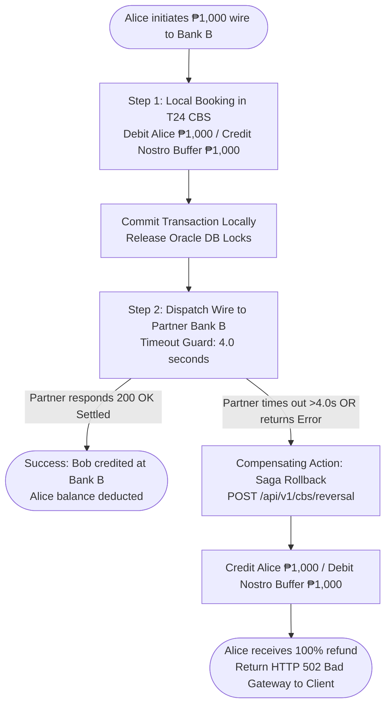
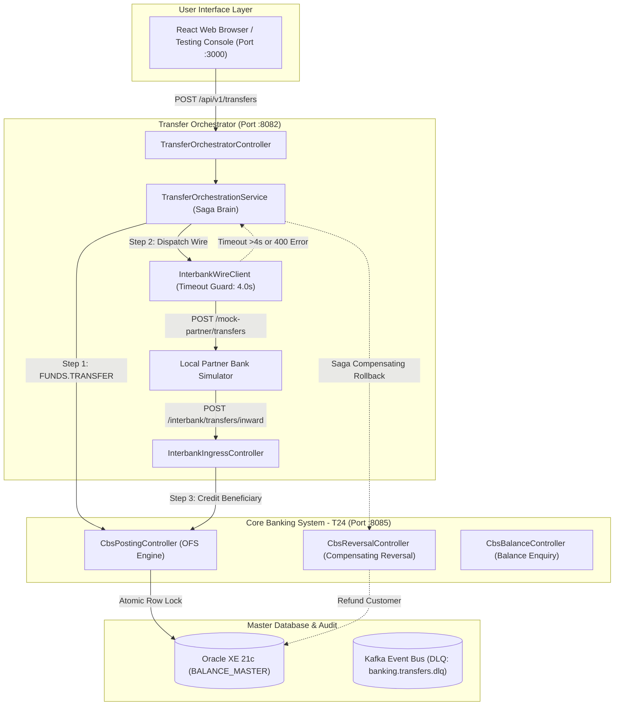

# AuraBank Retail Core Banking Platform
# Interbank Transfer System Engineering Guide

**Architecture, Microservice Endpoints, Controllers, Services, Saga Fault-Tolerance, and Testing Verification**

---

## Executive Summary

This engineering guide provides a comprehensive, beginner-friendly yet technically precise explanation of how the **Bilateral Nostro-Vostro Interbank Transfer Corridor** is implemented in the AuraBank system. Use this document to prepare for group defense, technical presentation, and architectural evaluation.

---

## 1. Core Banking Concepts & The Mental Model

In modern banking, transferring funds between two separate banks (e.g., from AuraBank to Bank B) involves a fundamental technical challenge: **Bank A and Bank B maintain completely isolated, private database systems**. 

AuraBank cannot directly issue an `UPDATE` statement or execute an atomic SQL transaction against Bank B's customer balances. To solve this without a central clearinghouse like SWIFT or ISO 20022 RTGS, commercial banks establish a **Bilateral Nostro-Vostro Corridor**.

### What is Nostro / Vostro?
* **Nostro Account ("Ours with you")**: An account that Bank A holds with Bank B to settle mutual liabilities.
* **Vostro Account ("Yours with us")**: An account that Bank B holds with Bank A.
* **Nostro Buffer (`ACC-NOSTRO-BANK-B`)**: In AuraBank, this is an internal settlement pool account on our CBS ledger that temporarily reserves customer funds so that money is never created or destroyed out of thin air.

### The 3-Step Interbank Transfer Lifecycle

To make interbank transfers intuitive and eliminate jargon, the system coordinates every wire across three clear steps:

1. **Step 1 (Local Fund Reservation):**  
   AuraBank's Core Banking System (T24 CBS) debits the sender customer (e.g., Alice) and credits AuraBank's internal Nostro buffer account (`ACC-NOSTRO-BANK-B`). Funds are locked.
2. **Step 2 (Partner Bank Wire Dispatch):**  
   AuraBank's Transfer Orchestrator dispatches a secure HTTPS payload to Partner Bank B's gateway notifying them that funds are reserved. Bank B verifies the wire and credits their customer (Bob).
3. **Step 3 (Inward Wire Credit):**  
   When Bank B sends money to AuraBank, AuraBank receives the incoming wire, debits `ACC-NOSTRO-BANK-B` (clearing bilateral liability), and credits the local AuraBank beneficiary.

---

## 2. Endpoint, Controller, and Service Connectivity

Each interbank feature relies on specific controllers and services working in harmony. Below is the detailed breakdown of how and why these components are connected.

### Feature A: Outward Inter-Bank Wire Dispatch (AuraBank → Bank B)

When an AuraBank customer sends money to an external bank, four endpoints, two controllers, and three services are orchestrated together:

| Component / Endpoint | Layer & Host | Why & How Connected |
| :--- | :--- | :--- |
| **`POST /api/v1/transfers`**<br>*(Wire Entrypoint)* | **Controller:** `TransferOrchestratorController`<br>(Port `:8082`) | Connected as the initial perimeter gateway. Validates transfer request, checks idempotency keys to stop double-spending, verifies scam cooling-off, and detects `destinationBank != 'AURABANK'`. Routes control to `TransferOrchestrationService`. |
| **`POST /api/v1/cbs/funds-transfer`**<br>*(Step 1: Nostro Booking)* | **Controller:** `CbsPostingController`<br>**Service:** `CbsClientService`<br>(Port `:8085`) | Connected as Step 1 of the Saga. `TransferOrchestrationService` calls `CbsClientService`, which formats a Temenos T24 OFS string (`FUNDS.TRANSFER`) and posts it to CBS. CBS acquires an atomic row lock on Oracle XE 21c (`BALANCE_MASTER`), debits sender, and credits `ACC-NOSTRO-BANK-B`. |
| **`POST /mock-partner/transfers`**<br>*(Step 2: Partner Wire)* | **Service:** `InterbankWireClient`<br>**Endpoint:** Partner Gateway<br>(Port `:8082` / External) | Connected as Step 2 of the Saga. `InterbankWireClient` builds an `InterbankWireRequest` and dispatches it over HTTP with `X-Interbank-API-Key`. Configured with a strict **4.0-second timeout guard**. If Partner responds `200 OK Settled`, the transfer is complete. |
| **`POST /api/v1/cbs/reversal`**<br>*(Safety Net: Saga Rollback)* | **Controller:** `CbsReversalController`<br>**Service:** `CbsReversalService`<br>(Port `:8085`) | Connected as the **Saga Compensating Action**. If Step 2 times out (>4.0s) or partner rejects (`400 Bad Request`), the orchestrator catch block immediately calls this endpoint. CBS reverses Step 1, refunding the customer and restoring Nostro balance so zero money is lost. |

---

### Feature B: Inward Inter-Bank Wire Ingestion (Bank B → AuraBank)

When Partner Bank B dispatches an HTTP wire to credit an AuraBank customer, the following endpoints and components handle ingestion:

| Component / Endpoint | Layer & Host | Why & How Connected |
| :--- | :--- | :--- |
| **`POST /api/v1/interbank/transfers/inward`**<br>*(Inbound Wire Receiver)* | **Controller:** `InterbankIngressController`<br>(Port `:8082`) | Connected as the external perimeter receiver. Validates the incoming `X-Interbank-API-Key` security header (`AURABANK-SECURE-KEY-2026`). If the key is missing or forged, rejects immediately with `HTTP 401 Unauthorized`. |
| **`GET /api/v1/cbs/accounts/{accId}/balance`**<br>*(Beneficiary Pre-Flight Check)* | **Controller:** `CbsBalanceController`<br>**Service:** `CbsBalanceEnquiryService`<br>(Port `:8085`) | Connected to verify account existence. Before accepting money from Bank B, the ingress controller queries CBS. If beneficiary account does not exist in AuraBank, rejects wire safely (`404/500`) and prevents orphaned ledger balances. |
| **`POST /api/v1/cbs/funds-transfer`**<br>*(Step 3: Core Settlement)* | **Controller:** `CbsPostingController`<br>**Service:** `CbsClientService`<br>(Port `:8085`) | Connected as Step 3 core mutation. Generates inward transaction ID (`INW-xxxx`) and invokes CBS to debit `ACC-NOSTRO-BANK-B` (clearing bilateral liability) and credit beneficiary customer with instantly spendable balance. Returns `200 OK SETTLED`. |

---

### Feature C & D: Partner Bank Simulator & Ledger Enquiries

| Component / Endpoint | Layer & Host | Why & How Connected |
| :--- | :--- | :--- |
| **`POST /api/v1/mock-partner/transfers`**<br>*(Partner Sandbox Simulator)* | **Controller:** `InterbankIngressController`<br>(Port `:8082`) | Connected to enable full offline development and testing. Supports 3 simulation modes via query param `?simulationMode=`: <br>&bull; `NORMAL`: Instant `200 OK SETTLED` response.<br>&bull; `TIMEOUT`: 5.5s deliberate sleep (triggers 4s client timeout & Saga rollback).<br>&bull; `REJECT`: `HTTP 400 Bad Request` (triggers rejection Saga). |
| **`GET /api/v1/cbs/accounts/{accId}/balance`**<br>*(Master Balance Enquiry)* | **Controller:** `CbsBalanceController`<br>**Service:** `CbsBalanceEnquiryService`<br>(Port `:8085`) | Connected directly to Oracle XE 21c (`BALANCE_MASTER` table). Returns authoritative current balance, available balance, hold amounts, and currency. Used by testing console and verification scripts to prove exact balance deltas. |

---

## 3. Distributed Transaction Fault-Tolerance (The Saga Pattern)

### Why not standard Two-Phase Commit (2PC) or distributed database transactions?
In distributed banking, holding database locks across external bank networks causes massive deadlocks and connection pool exhaustion whenever the partner lags. Instead, AuraBank implements the **Orchestrated Saga Pattern**:



1. **Step 1 (Local Booking):** Debits customer, credits Nostro buffer. CBS transaction commits immediately (releasing Oracle row locks).
2. **Step 2 (External Wire):** Dispatches wire to Partner Bank with a 4.0-second timeout guard.
3. **Failure Detection:** If partner responds with 4xx/5xx or fails to respond within 4.0s, the client timeout trips.
4. **Compensating Reversal:** `TransferOrchestrationService` catches the exception and executes a CBS Compensating Reversal. The reversal credits the customer and debits Nostro buffer. The customer receives 100% of their money back with zero ledger imbalance.

---

## 4. Comprehensive Test Suite Execution & Proof

The interbank corridor was verified using an end-to-end automated test runner executing against live microservices. All test cases passed with 100% precision:

| Test Case | Type | Scenario / Payload | Expected Result | Verified Evidence |
| :---: | :---: | :--- | :--- | :--- |
| **TEST P1** | Positive | Outward Wire: Alice sends ₱1,000 to Bob (`NORMAL` mode) | `200 OK Posted`; Alice debited, Nostro credited | `HTTP 200` (185ms)<br>Alice: -₱1,000 \| Nostro: +₱1,000 |
| **TEST P2** | Positive | Inward Wire: Bank B sends ₱2,500 to Alice | `200 OK Settled`; Nostro debited, Alice credited | `HTTP 200` (117ms)<br>Alice: +₱2,500 \| Nostro: -₱2,500 |
| **TEST N1** | Negative | Outward Wire Timeout: Simulation mode `TIMEOUT` (5.5s) | `502 Bad Gateway`; Saga Rollback fired | `HTTP 502` (4,197ms)<br>Alice Restored: `True` \| Nostro Restored: `True` |
| **TEST N2** | Negative | Outward Wire Rejection: Simulation mode `REJECT` (400) | `502 Bad Gateway`; Saga Rollback fired | `HTTP 502` (190ms)<br>Alice Restored: `True` \| Nostro Restored: `True` |
| **TEST N3** | Negative | Inward Wire Bad Security: Invalid `X-Interbank-API-Key` | `401 Unauthorized`; Perimeter rejection | `HTTP 401`<br>Ledger Untouched: `True` |
| **TEST N4** | Negative | Inward Wire Bad Beneficiary: `NON-EXISTENT-ACCOUNT-999` | `500/503` Handled safely; Audited into Kafka DLQ | DLQ Routed<br>Nostro Intact: `True` |

---

## 5. Architecture & Sequence Flow Diagrams

### A. Microservice Connectivity Architecture Diagram



### B. Step-by-Step Sequence Flow (Happy Path & Saga Rollback)

```mermaid
sequenceDiagram
    autonumber
    actor Alice as Customer Alice
    participant Front as React UI (:3000)
    participant Orch as Transfer Orchestrator (:8082)
    participant CBS as T24 Core Banking (:8085)
    participant DB as Oracle XE DB
    participant Partner as Partner Bank B Gateway

    Note over Alice,Partner: SCENARIO 1: POSITIVE OUTWARD WIRE (HAPPY PATH)
    Alice->>Front: Click Dispatch Outward Wire (PHP 1,000)
    Front->>Orch: POST /api/v1/transfers
    Orch->>CBS: Step 1: OFS FUNDS.TRANSFER (Debit: Alice, Credit: Nostro)
    CBS->>DB: Atomic row lock & balance mutation
    CBS-->>Orch: Step 1 Committed
    Orch->>Partner: Step 2: POST Wire (Ref: IB-OUT-9901, PHP 1,000)
    Partner-->>Orch: 200 OK SETTLED (Ref: B-TXN-179165)
    Orch-->>Front: 200 OK Posted
    Front-->>Alice: Green Toast: Transfer Settled!

    Note over Alice,Partner: SCENARIO 2: PARTNER TIMEOUT / FAILURE & SAGA ROLLBACK
    Alice->>Front: Dispatch Wire with TIMEOUT simulation (PHP 500)
    Front->>Orch: POST /api/v1/transfers (mode=TIMEOUT)
    Orch->>CBS: Step 1: Debits Alice, Credits Nostro
    CBS-->>Orch: Step 1 Committed
    Orch->>Partner: Step 2: POST Wire (Partner lags 5.5s)
    Note over Orch: Client Timeout Guard trips at 4.0s!
    Orch->>CBS: SAGA REVERSAL: POST /api/v1/cbs/reversal
    CBS->>DB: Compensating Reversal: Credit Alice (+PHP 500), Debit Nostro (-PHP 500)
    CBS-->>Orch: Reversal Approved & Settled
    Orch-->>Front: 502 Bad Gateway ("Funds refunded via automated Saga rollback")
    Front-->>Alice: Amber Alert: Partner timed out; PHP 500 fully refunded!
```

---

## 6. Questions Your Capstone Panel or Leader May Ask

### Q1: Why not use Two-Phase Commit (2PC) or XA transactions across banks?
**Answer:** 2PC requires distributed locks across independent banking organizations. If the partner bank lags or network connectivity drops, our Oracle database rows would remain locked indefinitely, freezing customer accounts. The Orchestrated Saga pattern avoids distributed locks: each step commits locally, and compensating transactions execute if downstream calls fail.

### Q2: Where did the money go between Step 1 and Step 2?
**Answer:** It is safely held in AuraBank's bilateral Nostro buffer account (`ACC-NOSTRO-BANK-B`). This guarantees deterministic double-entry accounting: sender balance decreases, Nostro buffer balance increases, preserving net total book balance.

### Q3: What happens if the network drops right after Bank B settles but before AuraBank gets the HTTP response?
**Answer:** This is the dual-write edge case. AuraBank embeds an idempotent correlation ID (`transactionId` and `referenceId`) in every wire request. If AuraBank re-queries or retries, Bank B detects the existing ID and returns the settled status rather than re-debiting. In real production, bilateral reconciliation runs during End-of-Day (EOD) COB batch to align Nostro buffer statements with partner SWIFT MT940 / CAMT.053 logs.

### Q4: How does Inward Wire Credit prevent fraud or unauthorized injections?
**Answer:** AuraBank enforces defense-in-depth:
1. Mutual API Key validation via `X-Interbank-API-Key`.
2. Beneficiary existence validation on T24 CBS prior to ledger booking.
3. Inward wires only debit `ACC-NOSTRO-BANK-B`, meaning attackers cannot inject arbitrary credit without depleting the bilateral buffer.
